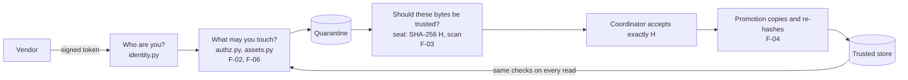

# Content Boundary Lab

> **v0.1 — Educational Preview / Work in Progress.** Verified on macOS ARM64 and CPython 3.13 only; no independent human
> review yet; one limitation open ([M4-01](docs/review/m4-findings.md)). [Limitations](#limitations-and-non-goals).

A security code-review lab: a service where an outside vendor delivers a file to a film or television production. Four
planted flaws, one function each, are reproduced as working exploits and then blocked by the corrected reference
application, so flaw and fix can be read side by side. It is not affiliated with, endorsed by or sponsored by any
company, standards body or product.

> **`labs/` contains intentionally vulnerable code. The default application does not**, and no switch, option or setting selects
> any of it. Every vulnerability here is deliberately constructed for education; none is a discovery in any third-party system.

Verified output ([summary.txt](docs/evidence/summary.txt); `python -m labs` itself ends with the last line):

<!-- evidence: docs/evidence/summary.txt -->
```text
F-02  seeded variant exploited and reference blocked: YES  (Object access checks the parent, not the child)
F-03  seeded variant exploited and reference blocked: YES  (Caller-declared checksum used as content identity)
F-04  seeded variant exploited and reference blocked: YES  (Promotion trusts a mutable reference, not the accepted bytes)
F-06  seeded variant exploited and reference blocked: YES  (Authorisation snapshot in a long-lived token)

4 exploits reproduced against the seeded variants; 4 blocked by the reference (4 findings).
```

| Finding | Boundary | Severity (in-scenario, educational) | CWE | ASVS 5.0.0 | Code | Tests | Evidence |
|---|---|---|---|---|---|---|---|
| **F-02** Object access checks the parent, not the child | TB3 | High | 639 | 8.2.2, 8.4.1 | [twin](labs/f02_parent_check/vulnerable.py), [fix](src/content_boundary_lab/assets.py) | [tests](tests/findings/test_f02_object_scope.py) | [f02](docs/evidence/f02.txt) |
| **F-03** Caller-declared checksum used as content identity | TB5 | Medium here: scan bypassed; promotion refuses the bytes | 807 | 5.4.3, 2.2.2, 16.5.3 | [twin](labs/f03_declared_identity/vulnerable.py), [fix](src/content_boundary_lab/trust.py) | [tests](tests/findings/test_f03_declared_identity.py) | [f03](docs/evidence/f03.txt) |
| **F-04** Promotion trusts a mutable reference, not the accepted bytes | TB4 | High if quarantine is writable after the seal | 367 | 15.4.2, 2.3.1, 2.3.3 | [twin](labs/f04_unverified_promotion/vulnerable.py), [fix](src/content_boundary_lab/promotion.py) | [tests](tests/findings/test_f04_unverified_promotion.py) | [f04](docs/evidence/f04.txt) |
| **F-06** Authorisation snapshot in a long-lived token | TB3 | High for a coordinator (a grant of up to 90 days from a 10-minute token); Medium for a vendor | 863 | 8.3.2, 7.4.2 | [twin](labs/f06_stale_authorisation/vulnerable.py), [fix](src/content_boundary_lab/authz.py) | [tests](tests/findings/test_f06_stale_authorisation.py) | [f06](docs/evidence/f06.txt) |

Passing tests show only that each seeded defect is reproducible and the corrected code blocks it, under the stated
assumptions. [Write-ups](#the-findings) below.

**Three questions.** Every request turns on *who are you* (a verified signed token), *what may you touch* (an engagement
looked up each time, in the production the URL names) and *should these bytes be trusted* (decided from bytes the server
hashed, never from what the sender declared). Each finding breaks one, in one function.



## Quick start

> **Requires macOS on Apple silicon (ARM64) and CPython 3.13.** The locked environment and every result here were verified on
> CPython 3.13.7 on macOS arm64 and nowhere else. On Linux, Windows, Intel Macs or Python 3.12 the hash-checked install is
> expected to be refused, and nothing is claimed for them ([Limitations](#limitations-and-non-goals)). Without that machine
> you can still read the [evidence](docs/evidence/summary.txt) and the [finding write-ups](#the-findings).

Three commands, then the demonstrations:

```bash
python3 -m venv .venv
.venv/bin/python -m pip install --require-hashes --only-binary=:all: -r requirements.lock
.venv/bin/python -m pip install --no-deps -e .
.venv/bin/python -m labs
```

The run ends with:

<!-- evidence: docs/evidence/summary.txt -->
```text
4 exploits reproduced against the seeded variants; 4 blocked by the reference (4 findings).
```

Each demonstration builds a throwaway synthetic world, runs the attacker's steps against the reference and against the
reference with only one function swapped, prints both, and exits 0 only if the seeded variant was exploited and the reference
blocked it. The [tour](docs/tour.md) shows each finding as context, flaw, attack, fix and result. A
[walkthrough](docs/walkthrough.md) takes you through the rest: the remediation matrices, one finding from write-up to code, and one
delivery through a real local server.

## Implemented, simulated and conceptual

| Status | What |
|---|---|
| Implemented | token verification; engagement authorisation; the production-scoped asset read; the delivery workflow from declaration through sealing, acceptance and promotion; the audit trail |
| Simulated | the identity provider (a development token issuer under `tools/`, and an in-memory one in the tests), the scanner (one synthetic marker), the object stores (two local directories) |
| Conceptual | cloud buckets, pre-signed URLs, federation, CSAP components |

The lab's scanner detects one synthetic marker. It provides no malware protection, and `no_detection` says nothing about whether a file is safe.

## The scenario in five bullets

- A **coordinator** of a production gives a person a time-boxed **engagement** as a vendor or a coordinator (an end date of
  at most 90 days is mandatory) and can revoke it.
- A **vendor** declares a delivery (name, size, SHA-256 and type, all *claims*), uploads the bytes into **quarantine**, and
  asks the server to **seal** it.
- At the seal the server hashes the stored bytes itself (**H**), compares the claims with what it measured, checks the
  signature allowlist, and reuses a stored `no_detection` verdict for H or asks the scanner.
- A coordinator accepts **exactly H**; a **system job** with no route then copies the bytes into the **trusted store**,
  hashing as it copies, and publishes them only if they are the accepted bytes.
- Engaged people read the asset through the API. Every decision the application or a system job commits leaves exactly one
  audit event, in the same transaction (an upload and a seal are two decisions; the router's own 404 and 405 answers, `seed-demo`
  and the removal of the lab's scratch files are not audited).

## The findings

Each finding is one function in the reference application and a seeded twin of it under [labs/](labs/README.md). The same
attacker's steps run against both; the seeded variant is exploited and the reference refuses. The quoted results are the
last line of each run's [evidence file](docs/evidence/f02.txt), which records its date, command, commit and versions.

### F-02: object access checks the parent, not the child

**Root cause.** The lookup checks that the caller is engaged in the production named in the URL, and then loads the asset by
its id alone; the asset's own production is never compared. **Impact.** A vendor engaged in one production reads another
production's unreleased asset.

<details><summary>The seeded twin, whole function</summary>

<!-- snippet: labs/f02_parent_check/vulnerable.py#get_asset_in_scope -->
```python
def get_asset_in_scope(conn, caller, production_id, asset_id, now_micros):
    row = conn.execute(_LOOKUP, (asset_id, production_id, caller.issuer, caller.subject, now_micros)).fetchone()
    return None if row is None else Asset(*row)
```

The reference, [`assets.get_asset_in_scope`](src/content_boundary_lab/assets.py), binds the asset, its real production, the
production the request named and the caller's current engagement in one statement.

</details>

Reproduce: `python -m labs.f02_parent_check` or `pytest tests/findings/test_f02_object_scope.py -v`.

<!-- evidence: docs/evidence/f02.txt -->
```text
RESULT     seeded variant exploited: YES   reference blocked: YES
```

**Limits.** Access is scoped per production, not per object within it. A caller engaged in both productions is entitled to
both assets, so for that caller the flaw is a wrong production binding (a read authorised and recorded under the wrong
production) and not a disclosure. Everything is synthetic. [Write-up](docs/findings/F-02-object-access-checks-the-parent.md).

### F-03: caller-declared checksum used as content identity

**Root cause.** The verdict cache is keyed on the checksum the vendor declared, not on a digest of the stored bytes, so a
`no_detection` verdict can be reused for different bytes. **Impact.** The scan boundary is bypassed: unscanned bytes reach the
point where a coordinator can accept them, under a verdict and a digest that were made for other bytes. Trusted storage is not
reached: the independent promotion control hashes what it copies and refuses them. That is why the severity is Medium in this
lab; it is not rated for a system without that control.

<details><summary>The seeded twin, whole function</summary>

<!-- snippet: labs/f03_declared_identity/vulnerable.py#content_identity -->
```python
def content_identity(delivery, stored):
    return ContentIdentity(delivery.declared_sha256)
```

The reference, [`trust.content_identity`](src/content_boundary_lab/trust.py), hashes the stored bytes in one pass and looks
at nothing else.

</details>

Reproduce: `python -m labs.f03_declared_identity` or `pytest tests/findings/test_f03_declared_identity.py -v`.

<!-- evidence: docs/evidence/f03.txt -->
```text
RESULT     seeded variant exploited: YES   reference blocked: YES
```

**Limits.** The scanner is synthetic, so the finding is about which bytes a verdict is applied to, not about detection. [Write-up](docs/findings/F-03-declared-checksum-used-as-content-identity.md).

### F-04: promotion trusts a mutable reference, not the accepted bytes

**Root cause.** Promotion copies whatever is in quarantine at promotion time and never compares what it wrote with the digest
the coordinator accepted. **Impact.** If something can write quarantine after the seal, the trusted store receives bytes that
nobody scanned or accepted, while the audit trail says the coordinator approved the delivery.

<details><summary>The seeded twin, whole function</summary>

<!-- snippet: labs/f04_unverified_promotion/vulnerable.py#copy_verified -->
```python
def copy_verified(source, target, promoting):
    for block in source.chunks():
        target.write(block)
    return target.finish()
```

The reference, [`promotion.copy_verified`](src/content_boundary_lab/promotion.py), counts and hashes the bytes as it writes
them and raises unless they are exactly the accepted bytes.

</details>

Reproduce: `python -m labs.f04_unverified_promotion` or `pytest tests/findings/test_f04_unverified_promotion.py -v`.

<!-- evidence: docs/evidence/f04.txt -->
```text
RESULT     seeded variant exploited: YES   reference blocked: YES
```

**Limits.** The attacker's ability to write quarantine after acceptance is assumed, not shown. Promotion checks that the bytes
are the accepted bytes; it does not look at anything that happened after the acceptance ([M4-01](docs/review/m4-findings.md)).
[Write-up](docs/findings/F-04-promotion-trusts-a-mutable-reference.md).

### F-06: authorisation snapshot in a long-lived token

**Root cause.** Authorisation comes from a `productions` claim that the identity provider put in the token, instead of from
the engagement store at the time of the request. **Impact.** A revoked or ended engagement is still honoured for the decisions
that rest on authorisation alone, until the token expires (at most ten minutes here). The lookups that re-check the engagement
(the asset read, the seal, the acceptance) still refuse. For a **coordinator** the window is not the whole impact: a revoked
coordinator can create an unauthorised engagement for another subject, up to 90 days long, and that grant is an ordinary row
that the reference honours after the token has expired and after the flaw is fixed, substantially longer than the token that
made it. For a **vendor** the window is the whole impact: it can still see its own engagement and declare a delivery.

<details><summary>The seeded twin, whole function</summary>

<!-- snippet: labs/f06_stale_authorisation/vulnerable.py#authorize_engagement -->
```python
def authorize_engagement(conn, identity, production_id, action, now_micros):
    claims = CARRIED.get()
    role = (claims.get("productions") or {}).get(production_id)
    if role is None:
        raise AuthorizationDenied(AuditReason.NO_ENGAGEMENT)
    if action not in POLICY.get(role, frozenset()):
        raise AuthorizationDenied(AuditReason.ROLE_NOT_PERMITTED)
    return AuthorizedEngagement("0" * 32, role, claims["exp"] * 1_000_000, _proof=_AUTHORIZED)
```

The reference, [`authz.authorize_engagement`](src/content_boundary_lab/authz.py), looks the engagement up on every request
and ignores every claim but identity.

</details>

Reproduce: `python -m labs.f06_stale_authorisation` or `pytest tests/findings/test_f06_stale_authorisation.py -v`.

<!-- evidence: docs/evidence/f06.txt -->
```text
RESULT     seeded variant exploited: YES   reference blocked: YES
```

**Limits.** A revocation is final for requests that begin after it commits; a transfer that has begun may finish. The
coordinator path uses the same single seam, and the grant it leaves survives the fix until it ends or is revoked. The lab has no
studio-administrator actor, so the revoked coordinator is revoked by its own call.
[Write-up](docs/findings/F-06-authorisation-snapshot-in-a-long-lived-token.md).

### Remediation matrices

`python -m labs.matrix` runs, for each finding, the original exploit, the behaviour that must keep working and the alternate
and boundary attempts against the reference, the seeded variant and the partial fixes that look like fixes and are not. It
prints `yes` where the required outcome holds and `NO` where it does not, and each of the four matrix files ends with:

<!-- evidence: docs/evidence/f02-matrix.txt -->
```text
RESULT     every variant fails exactly the rows it is expected to: YES
```

`pytest tests/findings -v` runs the same scenarios as tests, with the proof that no finding depends on another and that
nothing from `labs/` is reachable from the application. `pytest -m packaging` shows that neither the wheel nor the sdist holds
anything from `labs/`. F-01 and F-05 are optional in the design and are not built.

## Threat model, design decisions and trade-offs

The [threat model](docs/threat-model.md) lists the nine threats of the design and the rows the implementation added, each with
its control and the tests for it, or marked as a limitation or out of scope. The reasoning behind each choice is in
[decisions.md](docs/decisions.md); the main trade-offs are these.

- **One writer, serialised.** SQLite with a single write transaction per request: authorisation, the operation and its one audit event commit together or not at all. It costs concurrency, which the lab does not need.
- **Hash-bound chain.** Bytes, H, verdict, acceptance and the promoted bytes must all carry the same digest, and the server re-derives it at each step instead of trusting a caller's copy.
- **Intent first.** A filesystem rename and a database transaction are not one atomic act, so promotion records its intent, copies, publishes without replacing anything, and has a recovery pass that adopts only what it can prove.
- **Isolation by construction.** The seeded flaws are one function each, swapped in for the length of a `with` block, in a directory that is never packaged and that nothing in `src/` imports.

## Limitations and non-goals

- **One tested platform.** `requirements.lock` is verified for CPython 3.13.7 on macOS arm64. Linux and Python 3.12 are not verified, and the hash check refuses them until each has its own lock.
- **No independent review yet.** Three AI reviews, each in a context of its own and of the same model family as the author, are in [docs/review/](docs/review/m4-findings.md). They are an internal check, not an independent one. A human reviewer has not read the code (decision D10 is pending).
- **Accepted limits.** Promotion does not look at anything that happened after an acceptance (a revocation, an expired verdict, a later detection of the same bytes), and an acceptance cannot be withdrawn: [M4-01](docs/review/m4-findings.md), open at Medium, accepted and not resolved; the verdict cache is shared across productions; the lab makes no confidentiality claim against another local account and no defence against a party who can write its storage; a vendor's file name, extension included, is the name of the download and is not compared with the detected file signature or the declared type, and the coordinator is not shown it when accepting ([TM-40](docs/threat-model.md)); a wrong quarantine root looks like missing bytes ([TM-41](docs/threat-model.md)). Each is in the threat model and the [M4 register](docs/review/m4-findings.md) or the [follow-up record](docs/fresh-assessment-followup.md).
- **Synthetic parts.** The scanner, the identity provider and the object stores are stand-ins. The server listens on `127.0.0.1` with no TLS and is for local study.
- **Not built.** F-01 and F-05, a withdrawal for accepted content, a threat feed, a takedown after promotion, cloud storage, a front end.
- **Continuous integration** ([`.github/workflows/ci.yml`](.github/workflows/ci.yml)) has run once on GitHub, on the first push (2026-11-09): one macOS arm64 runner, CPython 3.13.17, and every step passed. That is one run on one platform; a guard test also reads the file's text.

## Run the lab locally

For local study only: it listens on `127.0.0.1` and nowhere else, with no TLS, and nothing in it is meant to face a network. Every value the lab trusts is named on the command line or fixed in the runner's code: there is no environment variable and no default, and the runner refuses to start without a loadable settings file and key set (regular files, not links, owned by the user running the lab and not writable by their group or by others: they decide who may sign in, so what matters is that nobody else can change them), a database of the lab's own schema, and two storage directories that are its own, not writable by anyone else, and separate places (every command that is given both roots refuses a pair that is one directory, nested, or two names for one place). The scanner is the synthetic one, and the start-up banner says so. Install the locked environment first, as under "Run the tests" below, and use that environment's `python`.

```bash
python tools/dev_token_issuer.py setup                       # a throwaway key, the trusted settings and two private directories in .dev/
python -m content_boundary_lab.runner init --database .dev/lab.sqlite3 --trusted-root .dev/trusted --quarantine-root .dev/quarantine
python -m content_boundary_lab.runner seed-demo --settings .dev/settings.toml --database .dev/lab.sqlite3
python tools/dev_token_issuer.py mint --subject dev-vendor-a       # a token for a vendor of the first synthetic production
python -m content_boundary_lab.runner serve --settings .dev/settings.toml --database .dev/lab.sqlite3 --trusted-root .dev/trusted --quarantine-root .dev/quarantine --max-upload-bytes 1048576 --port 8000
```

`serve` runs `uvicorn` as a library with one worker, no reload and no proxy headers, whatever the server's environment variables say (Python's own, such as `PYTHONPATH`, are the operator's: the tests start the runner with `python -I`). `promote`, `rescan` and `reconcile` are the lab's own jobs, run by the operator, and `reconcile` refuses to start while a server, a promotion or a rescan is running on the same directories. [Architecture](docs/architecture.md) section 14 describes each command and what it does to the lab. A delivery stranded in `SEALING` is listed by `reconcile` and nothing moves it: an operator investigates it (A-J7, a known availability limit). The [walkthrough](docs/walkthrough.md) runs one delivery through a real local server, command by command.

**Name the same quarantine root every time.** `promote`, `rescan` and `reconcile` cannot tell a mistyped `--quarantine-root` from a root whose files have gone: a delivery whose file is not at the root you name ends in `INTEGRITY_FAILED` (`promote`, `reconcile`; final, with an audit event that says the sealed content changed, which it did not) or stays in `SEALING` (`rescan`), and neither can be undone ([TM-41](docs/threat-model.md)). Keep the paths in one script or set of variables, and before a job check that the delivery's file is where you are about to say it is: read its storage key from the database (`SELECT storage_key FROM deliveries WHERE id = '…'`) and look for that name in the root.

To see the real server work, run `.venv/bin/python -m pytest -m real_server -s`: it starts `serve` on a random loopback port, speaks HTTP to it with synthetic data, and stops it. It needs `lsof` and is left out of the ordinary run.

## Run the tests

```bash
python3 -m venv .venv
.venv/bin/python -m pip install --require-hashes --only-binary=:all: -r requirements.lock
.venv/bin/python -m pip install --no-deps -e .
.venv/bin/python -m pytest -q
```

`requirements.lock` pins all 25 distributions, direct and transitive, by SHA-256 hash with one wheel file each, and the install command above accepts wheels only. It was last verified on 2026-11-04 for one environment: CPython 3.13.7 on macOS arm64. `cryptography`, `cffi` and `pydantic_core` ship compiled code, so those three wheels are specific to that platform. Other platforms and Python 3.12 are refused by the hash check until each has its own verified lock. `pyproject.toml` declares Python 3.12 or newer; no wider claim is made.

The direct runtime dependencies are `fastapi`, `PyJWT`, `cryptography` and `uvicorn` (the minimal install, not its `standard` extra); `cffi` and `pycparser` are installed only because `cryptography` needs them, and `click` only because `uvicorn` does. `PyJWT` and `cryptography` verify the signed tokens (`identity.py`), against public keys from trusted configuration only; nothing in the source tree can mint a token or hold a private key.

The build backend (`setuptools==84.2.1`) is version-pinned in `pyproject.toml` and installed by pip into a temporary build environment. It is not covered by the hashes.

`pip` itself is not in the lock. The one that ships with CPython 3.13.7 (25.2) has six published advisories, the latest fixed in 26.2; the hashes limit what it can install to the 25 locked wheels, but if you want a current installer, run `.venv/bin/python -m pip install --upgrade pip` before the install above (that one step is not covered by the hashes). The dependency audit is in [docs/review/static-analysis.md](docs/review/static-analysis.md).

Ordinary test runs check that the locked packages are installed at the locked versions and tolerate extra packages. To check that a fresh environment holds exactly the locked set, run `.venv/bin/python -m pytest -m clean_env`.

To check the documents against the repository, run `.venv/bin/python tools/check_docs.py`: it fails if a link or an anchor points at nothing, if a quoted snippet no longer matches the function it quotes, or if quoted evidence is not in its evidence file. With `--final` it also requires evidence made from a clean commit and from the code in your checkout. To regenerate the evidence, run `python -m labs --evidence docs/evidence` and `python -m labs.matrix --evidence docs/evidence` from a clean checkout.

## Documentation

- [Tour](docs/tour.md): the four findings in the same five steps each (context, planted flaw, attack, fix, result), with the real output.
- [Walkthrough](docs/walkthrough.md): install, the four findings, one finding from write-up to code, one delivery through a real local server, and how to verify and regenerate the evidence.
- [Architecture](docs/architecture.md): the pieces, the request flow, the delivery lifecycle, where bytes live, and what the database refuses on its own.
- [Threat model](docs/threat-model.md): actors, trust boundaries, and every threat with its control and the tests for it, or marked as a limitation or out of scope.
- [Claims register](docs/claims.md): every claim made here, each traced to the tests that show it, and the claims that are not made. This README makes no claim that is not in that register.
- [References](docs/references.md): the sources and versions behind every mapping, with retrieval dates.
- [Design decisions](docs/decisions.md): the amendments and assumptions, and the entry point for anyone working on the code.
- [Review package and register](docs/review/REVIEW-PACKAGE.md): the brief for a reviewer who has not seen the project, and the [register](docs/review/m4-findings.md) of everything the first review found.
- [Publication record](docs/publication.md): what the publication step checked and what is still open.
- [SECURITY.md](SECURITY.md): what is intentional and what to report.

## Responsible use and licence

Use the lab only on your own machine and with its synthetic data. Do not copy a seeded variant into a real system, do not point it at a network, and do not read the scanner's verdict as a statement about any file. Reports about the reference application are welcome; read [SECURITY.md](SECURITY.md) first, which separates a defect in the reference from an exhibit that is meant to fail.

The code, including the code quoted in the documents, is released under the [MIT licence](LICENSE). The documents (this README, SECURITY.md and `docs/`, evidence files included) are released under [CC BY 4.0](https://creativecommons.org/licenses/by/4.0/). Copyright (c) 2026 outsidethecode for both. The project is not affiliated with, endorsed by or sponsored by any company, standards body or product it names; names appear only to say what a source or a dependency is.
