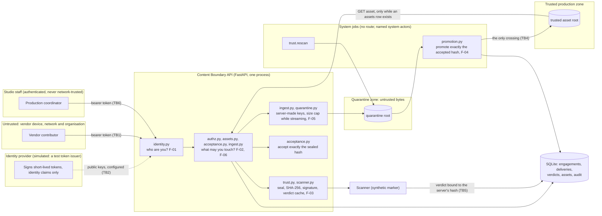

# Architecture

This describes the reference implementation as it is built through M1K, one section per thing a reviewer needs in order to
read the code: what the pieces are, where each trust decision is made, how a request and a delivery move, what the database
refuses on its own, and what is simulated. It does not repeat the reasoning behind each choice; that is in
[decisions.md](decisions.md) (the amendment, AM-n, is cited where a section depends on one). The threats these controls
answer are in [threat-model.md](threat-model.md), and every claim made about them is traced to a test in
[claims.md](claims.md). Where this file and `decisions.md` differ, `decisions.md` wins.

The lab is an independent educational exercise. The application here is the reference: it contains no deliberately
vulnerable code and no switch that selects any. The vulnerable variants are a later stage (M2), will live outside `src/`,
and are not built.

## 1. The three questions

The code is organised around three decisions that real failures in this area tend to blur together:

| Question | Decided by | Never decided by |
|---|---|---|
| **Who are you?** | [identity.py](../src/content_boundary_lab/identity.py): an ES256 token verified against configured public keys ([settings.py](../src/content_boundary_lab/settings.py)). It yields an issuer and a subject and nothing else. | A header a gateway supposedly sets; a role, scope or production claim inside the token. |
| **What may you touch?** | [authz.py](../src/content_boundary_lab/authz.py) and the scoped lookups, from SQLite, on every request, inside the request's write transaction. | The token's contents; the production named in a URL on its own. |
| **Should these bytes be trusted?** | [trust.py](../src/content_boundary_lab/trust.py), [acceptance.py](../src/content_boundary_lab/acceptance.py) and [promotion.py](../src/content_boundary_lab/promotion.py), from the bytes the server itself read and hashed. | A checksum, size, name or media type the sender declared. |

## 2. The system at a glance



The trust boundaries (TB1 to TB6) are defined in [threat-model.md](threat-model.md). Promotion is the only crossing of TB4.

## 3. Modules

| Module | Responsibility | Seam or finding | Main tests |
|---|---|---|---|
| [app.py](../src/content_boundary_lab/app.py) | `create_app(Dependencies)`: explicit dependencies, nine routes, no served documentation, no default scanner | isolation (M0 §5.5) | [test_app.py](../tests/test_app.py) |
| [runner.py](../src/content_boundary_lab/runner.py) | The composition root: the only code that builds `Dependencies`, from what the operator names and what the code fixes (clock, scanner, loopback address); the start-up checks and banner; the commands of section 14 | isolation (M0 §5.5), M1M | [test_runner.py](../tests/test_runner.py), [test_runner_workflow.py](../tests/test_runner_workflow.py), [test_runner_maintenance.py](../tests/test_runner_maintenance.py), [test_runner_scope.py](../tests/guards/test_runner_scope.py) |
| [identity.py](../src/content_boundary_lab/identity.py), [settings.py](../src/content_boundary_lab/settings.py) | ES256 verification against 1 to 8 configured P-256 keys, zero clock skew, header `alg`/`typ`/`kid` only; trusted configuration, and the refusal of the reserved `system:` issuer namespace | F-01 | [test_identity.py](../tests/test_identity.py), [test_settings.py](../tests/test_settings.py) |
| [request_flow.py](../src/content_boundary_lab/request_flow.py) | The one order every request follows (section 5); `decide`, `proceed`, `respond`, and `run_system` for system jobs | all | [test_engagements_api.py](../tests/test_engagements_api.py), [test_request_flow_phases.py](../tests/test_request_flow_phases.py) |
| [authz.py](../src/content_boundary_lab/authz.py) | `authorize_engagement`: role, end date and revocation of the caller's engagement in the URL's production, from SQLite; a closed action policy | F-06 | [test_authz.py](../tests/test_authz.py) |
| [engagements.py](../src/content_boundary_lab/engagements.py), [management.py](../src/content_boundary_lab/management.py) | A caller's own engagement; a coordinator creates (mandatory, capped end date) and revokes engagements | F-06 | [test_engagements_api.py](../tests/test_engagements_api.py), [test_engagement_creation_api.py](../tests/test_engagement_creation_api.py), [test_engagement_revocation_api.py](../tests/test_engagement_revocation_api.py) |
| [assets.py](../src/content_boundary_lab/assets.py) | Read: the one scoped asset query and the download. Write: the trusted-root primitives (staging, no-clobber publish, removal by identity, fingerprinting) | F-02, F-04 | [test_asset_lookup.py](../tests/test_asset_lookup.py), [test_asset_files.py](../tests/test_asset_files.py), [test_trusted_store.py](../tests/test_trusted_store.py) |
| [ingest.py](../src/content_boundary_lab/ingest.py), [quarantine.py](../src/content_boundary_lab/quarantine.py) | A vendor declares and uploads; the only code that writes quarantine; server-made names; the read-back opener | F-05 | [test_delivery_initiation_api.py](../tests/test_delivery_initiation_api.py), [test_delivery_upload_api.py](../tests/test_delivery_upload_api.py), [test_quarantine.py](../tests/test_quarantine.py) |
| [trust.py](../src/content_boundary_lab/trust.py), [scanner.py](../src/content_boundary_lab/scanner.py) | Seal: hash the stored bytes once (`content_identity`), compare with the declaration, check the signature allowlist, consult the verdict cache, call the scanner; the internal rescan | F-03 | [test_seal_api.py](../tests/test_seal_api.py), [test_scanner.py](../tests/test_scanner.py), [test_rescan.py](../tests/test_rescan.py) |
| [acceptance.py](../src/content_boundary_lab/acceptance.py) | A coordinator inspects the sealing result and accepts the sealed digest H | hash binding | [test_acceptance_api.py](../tests/test_acceptance_api.py) |
| [promotion.py](../src/content_boundary_lab/promotion.py) | The promotion job: copy while hashing, publish, finish; the recovery pass | F-04 | [test_promotion.py](../tests/test_promotion.py) |
| [store.py](../src/content_boundary_lab/store.py), [audit.py](../src/content_boundary_lab/audit.py), [clock.py](../src/content_boundary_lab/clock.py) | The schema, its constraints and triggers, and hardened connections; the closed audit vocabulary and the one append; an injectable UTC clock | baseline | [test_store.py](../tests/test_store.py), [test_store_hardening.py](../tests/test_store_hardening.py), [test_audit.py](../tests/test_audit.py), [test_clock.py](../tests/test_clock.py) |

## 4. What is served, and what runs without a route

| Method and path (under `/productions/{production_id}`) | Who | Does |
|---|---|---|
| `GET /engagement` | any engaged caller | shows the caller's own role and end time |
| `POST /engagements` | coordinator | creates an engagement (end date mandatory, capped at 90 days) |
| `POST /engagements/{engagement_id}/revoke` | coordinator | revokes an engagement of this production |
| `GET /assets/{asset_id}` | any engaged caller | downloads a trusted asset of this production |
| `POST /deliveries` | vendor | declares a delivery |
| `PUT /deliveries/{delivery_id}/content` | the delivery's vendor | streams its bytes into quarantine |
| `POST /deliveries/{delivery_id}/seal` | the delivery's vendor | closes it; the server decides |
| `GET /deliveries/{delivery_id}/seal` | coordinator | shows what the seal found |
| `POST /deliveries/{delivery_id}/accept` | coordinator | accepts the sealed digest |

Every route requires a verified token ([test_every_route_requires_a_token.py](../tests/test_every_route_requires_a_token.py)). Two operations have no route
because M0 makes them the lab's own work and not a caller's: `trust.rescan` (an internal re-entry into the gate) and
`promotion.promote` with `promotion.reconcile` (M0's "System job"). They are functions for the operator's code, run under
the named system actors `system:content-boundary-lab` / `rescan` and `promote`, and a guard fails if anything else starts
one ([test_delivery_scope.py](../tests/guards/test_delivery_scope.py)). Since M1M the operator reaches them through the
runner's `promote`, `rescan` and `reconcile` commands (section 14); that is a command line, not a route.

## 5. One request, in order

The order is the property the module exists to keep; an endpoint supplies only its action and its operation.

1. Open a hardened connection (`store.connect`) in the handler thread.
2. `BEGIN IMMEDIATE`: the request now holds the writer lock, so a revocation that committed earlier is seen and one that
   commits later waits.
3. Read the injected clock once. That instant is the request's for everything below.
4. Authenticate the bearer token on that instant. Any failure is the same 401; the reason is recorded, never returned.
5. Authorise the action in the URL's production on that instant, from the engagement row.
6. Run the operation: look the object up with one statement that binds the object, its real production, the production the
   URL named, the caller's identity and a current engagement; change state by compare-and-set; append one audit event.
7. Check that exactly one audit event was appended; if not, roll back and answer 500.
8. `COMMIT`, then build the response. A download streams after the commit, so a slow client never holds the lock.

A request whose bytes arrive after its first decision (an upload, a seal) is two or three short transactions with the file
work between them, and never holds the writer lock while a file is read, hashed, scanned or copied. A system job uses
`run_system`: the same transaction, one clock read and exactly-one-event rules, with a named system actor in place of a
caller. SQLite and the filesystem are not one transaction and nothing here claims they are; where a file operation sits
inside a transaction, a failure takes back the exact file that was placed and nothing else.

## 6. The delivery lifecycle

```mermaid
stateDiagram-v2
  [*] --> INITIATED: vendor declares
  INITIATED --> UPLOADED: bytes streamed to quarantine
  UPLOADED --> SEALING: vendor seals; writes close
  SEALING --> REJECTED: checksum or size mismatch, unsupported type, detection
  SEALING --> SCAN_FAILED: scanner unavailable, timeout, bad response
  SEALING --> SCAN_PASSED: no_detection verdict bound to H
  SEALING --> INTEGRITY_FAILED: rescan re-hash differs from H
  SCAN_FAILED --> SEALING: internal rescan
  SCAN_PASSED --> SEALING: internal rescan (verdict stale)
  SCAN_PASSED --> ACCEPTED: coordinator accepts H
  ACCEPTED --> PROMOTING: promotion begins
  PROMOTING --> PROMOTED: bytes verified, published, committed
  PROMOTING --> INTEGRITY_FAILED: bytes differ from H
  REJECTED --> [*]
  PROMOTED --> [*]
  INTEGRITY_FAILED --> [*]
```



The twelve arrows are the only ones the database allows (`deliveries_follow_the_lifecycle`); each is made by exactly one
code path, under one actor, with one audit event:

| Arrow | Made by | Actor | Audit event |
|---|---|---|---|
| INITIATED → UPLOADED | `ingest` | the owning vendor | `delivery.uploaded` |
| UPLOADED → SEALING | `trust` (seal, first transaction) | the owning vendor | `delivery.seal_started` |
| SEALING → REJECTED, SCAN_FAILED, SCAN_PASSED | `trust` (seal, second transaction) | the owning vendor | `delivery.rejected`, `delivery.scan_failed`, `delivery.scan_passed` or `delivery.verdict_reused` |
| SCAN_FAILED, SCAN_PASSED → SEALING | `trust.rescan` | `rescan` | `delivery.rescan_started` |
| SEALING → INTEGRITY_FAILED | `trust.rescan` | `rescan` | `delivery.integrity_failed` |
| SCAN_PASSED → ACCEPTED | `acceptance` | a coordinator of the production | `delivery.accepted` |
| ACCEPTED → PROMOTING | `promotion.begin` | `promote` | `delivery.promotion_started` |
| PROMOTING → PROMOTED | `promotion.publish` | `promote` | `delivery.promoted` |
| PROMOTING → INTEGRITY_FAILED | `promotion.fail` | `promote` | `delivery.integrity_failed` |

H is the SHA-256 of the stored bytes that the server computed at seal time through the single function
`trust.content_identity`. It is the digest the declared hash is compared with, the verdict-cache key, the digest a verdict
is bound to, the digest a coordinator accepts and the digest promotion checks. The declared hash is a claim to compare and
is never an identity (AM-23).

## 7. Where bytes live

```
<quarantine root>/.incoming/<name>     bytes arriving; <name> is 32 random hex characters
<quarantine root>/<storage key>        one delivery's bytes; the key is server-generated (32 hex characters)
<trusted root>/.staging/<attempt>      a promotion's copy while it is verified; <attempt> is server-generated
<trusted root>/<asset id>              one asset's bytes; the id is server-generated and equals its assets row
```

The two roots are separate directories (neither may contain or lead to the other) and only `quarantine.py` and `assets.py`
open, move or delete files. Every operation opens the root as a directory without following a symlink in its last component
and works relative to that descriptor with one basename that has been checked to be 32 lowercase hexadecimal characters; no
client text is ever a path component. Staged files are created exclusively with mode 0600. Placement is a hard link that
fails if anything occupies the name, so nothing is replaced. A file at a final name is deleted only when it is the exact
file (device and inode) the same writer just placed; the other deletions are of names in the server's own staging
directories. A file is served only while its `assets` row exists, so a file on disk without a row is not an asset.

## 8. What the database refuses on its own

The schema is one initial version (`SCHEMA_VERSION` is 1, no migrations), checked against a reference on every connection.
Application connections run under a default-deny authorizer. The invariants below do not depend on the application code
that normally upholds them.

| Subject | Refused |
|---|---|
| Audit | any update, delete or replacement of an event |
| Engagements | any change to a revoked engagement; a subject's issuer and subject changing |
| Deliveries | deletion or replacement; a change to identity or declared values; a state change that is not one of the twelve arrows |
| Receipt and seal | a change to either once written; a state after sealing with no seal |
| Verdicts | any update, delete or replacement |
| `SCAN_PASSED`, `ACCEPTED` | entry without a `no_detection` verdict bound to the delivery's own sealed digest |
| Acceptance | half a record; a digest other than the sealed one; any change once written |
| Promotion | a record outside `PROMOTING` and later; a change once written; `PROMOTED` without an asset row naming this delivery, production, accepted digest and size under the reserved key |
| Assets from a delivery | insertion unless that delivery is `PROMOTING` for exactly these values; later update, deletion or replacement |

## 9. Audit

An append-only table written only through `audit.record_event`, inside the transaction of the decision it records, so the
two commit together or not at all. The vocabulary (actions, reasons, object types, outcomes, engine kinds) is closed: a
member is added by a reviewed change, and there is no free-text field. Every request or system transaction appends exactly
one event, and the flow counts them before it commits. The actor is the verified caller, or one of the two named system
actors; the namespace `system:` is refused to every token issuer and to every other actor. The table is not tamper-evident:
anyone who can write the database file can change rows and put the triggers back.

## 10. The seams

M0 isolates each finding in one function that a vulnerable variant would replace. The variants are not built; this table
records where the reference decision is made, and where the name in the Addendum differs from the function in the code.

| Finding | Addendum name | Where the reference decides | Note |
|---|---|---|---|
| F-02 | `get_asset_in_scope` | `assets.get_asset_in_scope` | as named |
| F-03 | `content_identity` | `trust.content_identity` | as named |
| F-04 | `copy_verified` | `promotion.copy_verified` | as named; the comparison with the accepted digest is in this function only (the recovery pass has its own, for a file that is already at the key) |
| F-06 | `active_engagement` | `authz.authorize_engagement` (its engagement lookup) | no function of the Addendum's name exists; M2 chooses the seam |
| F-01 (optional) | `authenticate` | `identity.authenticate` | as named; not built as a variant |
| F-05 (optional) | `storage_key_for` | the server-made key in `store.add_delivery`, checked by `quarantine` and `assets` | no function of the Addendum's name exists; M2 chooses the seam |

## 11. Implemented, simulated, conceptual

| Status | What |
|---|---|
| Implemented | token verification; engagement authorisation; the scoped asset read; the delivery workflow from declaration to promotion; the verdict cache and the hash-bound trust gate; the audit trail; the recovery passes (rescan, promotion reconcile) |
| Simulated | the identity provider (a development token issuer under `tools/`, and an in-memory one under `tests/`); the scanner (one synthetic marker); the object stores (two local directories) |
| Conceptual | cloud buckets, pre-signed URLs, OIDC federation, CSAP's separate components |
| Not built | recovery of a delivery stranded in `SEALING` (an operator investigates; A-J7); the vulnerable variants, their exploits and the finding write-ups (M2); the optional F-01 and F-05 variants |

## 12. CSAP analogy and cloud mapping

These are analogies, not conformance, and nothing in the code depends on them.

- **CSAP** (MovieLabs Common Security Architecture for Production, Part 1) separates an Authentication Service, an
  Authorization Service, an Authorization Rules Distribution Service and Policy Enforcement Points. Token verification
  here consumes the Authentication Service's output. The engagement checks combine the Authorization Service and a
  Policy Enforcement Point inside one application, which CSAP keeps separate; that is a stated limitation. CSAP's trust
  inference and device posture are conceptual only. CSAP says that making sure a trusted artefact is actually trustworthy
  is not its role; the content-trust half of this lab is aimed at that gap.
- **Cloud mapping** (documented, not implemented, and not verified against any provider): separate buckets or accounts for
  quarantine and trusted storage, with distinct roles allowed to write each; sealed objects that are immutable or
  versioned, with promotion pinned to a specific version; verdicts writable only by the scanner's role; federation through
  OIDC. The provider-specific details are open item V3 in [decisions.md](decisions.md).

## 13. Assumptions and known limits

- The quarantine and trusted roots are local directories that untrusted users cannot write to; a mistaken root is not
  something the code can detect. A hard link planted by someone who can already write into a root is invisible to a
  no-follow open. After a file has been verified and before it is recorded, a process with write access to the trusted
  root could change it; the code narrows that window (a fingerprint checked inside the recording transaction) and does not
  claim to close it. After promotion a trusted file is not verified again.
- `fsync` orders writes; it does not claim durability across a power failure.
- Verdict validity is checked at acceptance and not at promotion (a documented gap in the Addendum).
- The scanner is synthetic. The signature allowlist is illustrative and easy to bypass.
- A delivery stranded in `SEALING` (a seal or rescan that met a missing or changed file, or a failed commit) is not
  recovered (A-J7): `reconcile` lists it and moves nothing, because M0 gives `SEALING` no abandonment rule, and an
  operator must investigate it. This is a known availability limitation.
- The asset route is registered first and its path parameters are greedy, so a `GET` whose delivery id contains `assets/`
  is answered by the asset route (403, not 404); malformed-URL answers are not uniform across routes. Every route
  authenticates before it looks at the path.
- `ingest.reconcile` and `promotion.reconcile` are maintenance-window operations, and the runner now enforces the window
  for the lab's own processes (section 14); they are still not scheduled, and the exclusion is advisory and local.
- The audit table is not tamper-evident, and nothing here rate-limits requests that each take the writer lock.

## 14. Running the lab

[runner.py](../src/content_boundary_lab/runner.py) is the one place the lab's trusted dependencies are chosen. It builds
`Dependencies` and nothing else does ([test_runner_scope.py](../tests/guards/test_runner_scope.py)). The operator **names**
the settings file (and through it the trusted issuer, the audience and the public keys), the database, the trusted root, the
quarantine root, the upload limit and the port. The code **fixes** the clock (the system clock, in UTC), the scanner and its
policy (the synthetic marker scanner, whose identity and policy fingerprint every verdict carries) and the address
(`127.0.0.1`). There is no environment variable, no default for any option, and no option for an address, a scanner, a
clock, a policy or a switch. The development token issuer ([dev_token_issuer.py](../tools/dev_token_issuer.py)) stands
outside the package: it makes a throwaway key, the settings that name only its public half, and short-lived tokens.

| Command | What it does | Holds the quarantine root |
|---|---|---|
| `init` | creates the schema in a new database, which only its owner can read (the two roots must already exist) | no |
| `seed-demo` | puts two synthetic productions, each with a coordinator and a vendor, in a database that has none | no |
| `serve` | composes the application, prints the banner, and runs `uvicorn` on `127.0.0.1` and the port | shared, while serving |
| `promote` | promotes one accepted delivery (`promotion.promote`, as the `promote` system actor) | shared |
| `rescan` | re-enters the gate for one delivery whose scan failed or whose verdict no longer counts (`trust.rescan`, as the `rescan` system actor) | shared |
| `reconcile` | `ingest.reconcile`, `promotion.reconcile`, and a listing of the deliveries stranded in `SEALING` | exclusive |

**Starting is all or nothing.** Before it takes a lock, prints or binds, a start loads the settings and the key set (a
missing or unreadable file, a URL, no keys, or private key material ends it), checks the database (a regular file, the
user's own, closed to group and others, at the lab's schema version with every schema object as expected) and each root (a
directory and not a link, the user's own, closed to group and others, and the two separate). A refusal says which check
failed and repeats nothing a file held, and the disk is as it was. Parent directories are not examined: the trusted
operator controls where the lab keeps its data.

**What the processes tell each other.** Reconciliation removes the server's own scratch files and finishes or reports what a
crash left behind. During an upload or a promotion that would damage the work, and nothing outside the process can tell the
two apart, so each process says what it is doing through a `flock(2)` on the quarantine root directory
([quarantine.hold](../src/content_boundary_lab/quarantine.py)):

| Holder | Mode | Refused while |
|---|---|---|
| the server, a promotion, a rescan | shared | `reconcile` runs |
| `reconcile` | exclusive | any of them runs |

Nothing waits: a refused command exits at once with status 3. (uvicorn also exits with 3 when it cannot start, for
instance when the port is taken; the message says which.) The kernel drops the lock when its holder ends, by a crash or a
kill, so there is no stale lock to clear. It is advisory (a process that does not ask is not kept out), it means one local
filesystem, and a person who can write to the roots can do anything. With the lock held exclusive no seal or rescan is in
flight, so every delivery `reconcile` lists as stranded in `SEALING` is certainly not being worked on. The lab still does
not move one, and adds no timeout, command or audit reason for it: M0 gives `SEALING` no abandonment rule, so an operator
must investigate each one. That is a known availability limitation and not a claim that every recovery path is complete
(A-J7, [decisions.md](decisions.md) AM-27).

**The server.** `serve` runs `uvicorn` 0.54.0, the minimal install, as a library, with an application object and these
settings fixed as literals in one call: `host="127.0.0.1"`, the operator's port, `workers=1`, `reload=False`, `http="h11"`,
`loop="asyncio"`, `proxy_headers=False`, `server_header=False`. Nothing else is passed, so nothing outside that call can
change it: left to its defaults uvicorn takes the worker count from `WEB_CONCURRENCY` and believes `X-Forwarded-*` from the
loopback, and its `UVICORN_*` variables and `.env` loading belong to its own command line, which is not used. The real server
is imported in one function of the runner, and not at all by a lab that does not serve.

**What the real run showed.** `pytest -m real_server` ([test_real_server.py](../tests/test_real_server.py)) starts that
command as a separate program in an environment holding `WEB_CONCURRENCY=4`, `FORWARDED_ALLOW_IPS=*` and `UVICORN_HOST=0.0.0.0`,
and talks to it over TCP with `http.client`: one process, one listener at `127.0.0.1:<port>` and no other socket (read with
`lsof`), the banner before uvicorn's own start-up lines, the generic 401, signed development tokens, the whole delivery path
with a 3 MiB streamed upload and download that are the exact bytes, 413 for an oversize upload declared either way, cross-
production denial, a revoked vendor's valid token refused on the next request, a client that disconnects in the middle of an
upload and of a download (no descriptor left open, no staged file, the delivery still `INITIATED`, the server still
serving), `reconcile` refused while the server runs, and a clean stop on SIGINT that releases the port and the lock. It is
one server on one machine with synthetic data. It does not exercise TLS, load, hostile clients or malformed requests beyond
those named, and it is not a statement about any other use.
