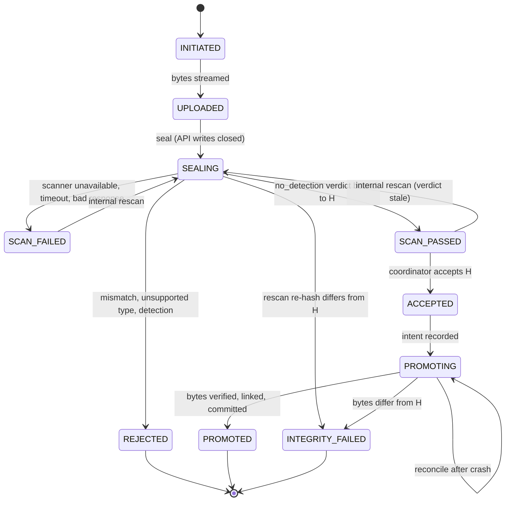

> **Preserved record.** This is the M0 Addendum / Final Design Decision Record exactly as reviewed and accepted on 2026-11-03, copied verbatim from the Claude Code session in which it was written. The only omission is the one-line chat preamble that preceded the title ("Writing up the addendum now."). It has not otherwise been edited; statements such as "nothing in the repo changed" describe the state when it was written. It corrects [M0.md](M0.md). Amendments made after its acceptance are recorded in [../decisions.md](../decisions.md), which takes precedence where they differ.

---

# M0 Addendum / Final Design Decision Record

**Status:** proposal only. Nothing in the repo changed, and nothing was installed, committed or pushed. The original M0 text isn't in the repo, so I recovered it from the earlier session's transcript. Tags are as in M0, plus **[Unverified→Vn]** for new claims I haven't checked against a source.

## Read first: the GitHub repo is already public

A read-only `gh repo view` shows `outsidethecode/content-boundary-lab` is **PUBLIC**. `origin` is configured, and the root commit was created in GitHub's web UI. Its author email is the company-domain address from M0 D9, so that address is already in public history. Your local git config would put your personal Gmail on future commits.

Every push you make publishes immediately. I treat D9 as a blocker before the next commit (§8, A1). I changed nothing.

## 1. Exact corrections to the original proposal

Unchanged and not repeated: the actors, assets and TB1–TB6 list, the F-02 write-up, CWE/ASVS mappings (except where noted), the stack, and M4/M5 intent.

| # | Original | Correction |
|---|---|---|
| C1 | §0, §8 framing | The deliverable is a **secure code review and remediation lab**. The app is the system under review, and the default build is its remediated state. Every vulnerability is **seeded** (constructed), never "found". README, every finding page, `labs/README` and SECURITY.md carry one fixed sentence: *"Every vulnerability here is deliberately constructed for education; none is a discovery in any third-party system."* §1 row 4 ("plausible motive") stays, relabelled "constructed rationale". |
| C2 | §5 finding format | Every finding page and README card uses 7 headings: Context, Boundary, Vulnerable code and root cause, Exploitation scenario, Corrected code, Before/after results (verbatim output), Residual risk and assumptions. A finding without captured evidence is not listed in the README. |
| C3 | §5 F-04 | The root cause named two conditions ("writable after seal" plus "unverified promotion") but only one seam. Corrected in §5.4. |
| C4 | §5 F-03 | The mismatch check would make the declared-hash cache path unreachable, and "scan runs on the server-computed hash either way" was wrong. Seam restated; impact narrowed (§3 R1, §5.2). |
| C5 | §4 state machine | Scanner error or timeout was folded into `Rejected`. The split in §5.2 is: *no determination* is not *rejection*. It also adds `SEALING` and `PROMOTING`. |
| C6 | §6, §7 isolation | Explicit factory DI only. `dependency_overrides` is banned. The test token issuer moves out of `src/` (§5.5). |
| C7 | §5 F-01 | "Gateway assumption" is a defect only relative to a *documented* direct-reachability boundary (§5.6). Optional. |
| C8 | §2 step 8, §5 F-06 | "Next request is denied" means the first request that *starts after the revocation commit*. Scope matrix in §5.7. |
| C9 | §5 ordering, §9 M4 | Four core findings; F-01 and F-05 optional. The claims register starts at M1A, not M4. |
| C10 | §9 M1–M3 | M1 becomes M1A–M1M. M2 and M3 merge into one slice per finding (§6). |
| C11 | §5 severities | F-04 "High" becomes conditional. F-01 "Critical" is removed unless its premise is shown. |
| C12 | §7 D5/D6 | Dependencies are staged by first use, and the build backend counts as one. "Python ≥3.12" is claimed only for versions actually run. |
| C13 | §10 risk "findings look planted" | Replaced by "findings mistaken for discoveries", mitigated by C1. |

## 2. Final decision table, D1–D7

| ID | Original | Final | Status |
|---|---|---|---|
| D1 | All six, drop F-01 first | **Core four: F-02, F-04, F-03, F-06.** F-01 and F-05 are optional, with an admission test (§4). | Decided by you |
| D2 | Trusted-header F-01 | Deferred with F-01. If admitted, it is the header-trust variant framed against the documented premise. Disabled-signature stays rejected. The baseline always verifies tokens locally. | Deferred |
| D3 | Declared-hash scan cache | Kept, restated as "caller-declared checksum used as content identity". Seam is `content_identity`. Mass-assignment stays rejected. | **Needs your OK** (seam and impact changed) |
| D4 | Per-production scope | Unchanged. Over-exposure *within* a production stays a stated limitation. | Confirmed |
| D5 | Dependency list | Stack accepted as a proposal. Each dependency is added in the slice that first uses it, after you approve its exact `==` pin. The full transitive set is reported. | Per-slice approval |
| D6 | Python ≥3.12 | Kept. The README claims only what was run: 3.13.7 locally (re-checked today); 3.12 needs its own run. | Confirmed with caveat |
| D7 | Qualitative severity | Unchanged, labelled "in-scenario, educational severity". F-04 is conditional. | Confirmed |

## 3. Remaining risks and unresolved contradictions

- **R1: F-03 impact vs the F-04 control.** With the seam `content_identity` returning the declared hash, the reference promotion would still catch the swap, because the copy hash ≠ the accepted value. So the F-03 demo ends at "unscanned bytes reach `SCAN_PASSED` and are acceptable". It must *not* claim they reach `trusted/`. F-03 and F-04 stay separate: one is where content identity comes from, the other is verification at use.
- **R2: F-04's attacker capability is assumed.** The lab does not show that quarantine is writable in any real deployment. Severity is "High only if something other than the app can write quarantine after sealing; otherwise a defence-in-depth finding".
- **R3: crash tests simulate process crashes** by constructing intermediate states. Power loss, filesystem reordering and macOS `fsync` behaviour are untested, and no durability claim is made [Unverified→V8].
- **R4: scanner timeout is tested at the adapter contract.** A scripted fake raises `ScannerTimeout`. The in-process stub can't be preempted, and the lab claims no real preemption.
- **R5: recovery assumes one process.** There are no leases, so multi-worker operation is out of scope.
- **R6: mappings need a recheck.** CWE-807/348 for F-03 and CWE-367 for F-04 apply to reframed findings. CWE-354 (Improper Validation of Integrity Check Value) is a candidate whose mapping usage I haven't checked [Unverified→V9].
- **R7: guard tests catch accidents and drift.** They don't stop a maintainer who deliberately edits them.
- **R8: the decision record exists only in local transcripts, and the repo is public.** See A1 and A2.

## 4. Prioritised finding set

| Pri | ID | Revised title | Seam (one function) | Vulnerable decision |
|---|---|---|---|---|
| 1 | F-02 | Object access checks the parent, not the child | `get_asset_in_scope` | Loads by asset id after checking only the path's production |
| 2 | F-04 | Promotion trusts a mutable reference, not the accepted bytes | `copy_verified` | Copies quarantine → trusted without hashing |
| 3 | F-03 | Caller-declared checksum used as content identity | `content_identity` | Returns the declared SHA-256 instead of hashing stored bytes |
| 4 | F-06 | Stale vendor authorisation | `active_engagement` | Reads a `productions` claim baked into the token |
| opt | F-01 | Identity from a header | `authenticate` | Reads a subject header |
| opt | F-05 | Client filename builds the path | `storage_key_for` | Joins the client filename into the path |

Priority reflects credibility. Build order is F-02 → F-06 → F-03 → F-04, by dependency and difficulty.

**Admission test for F-01 and F-05.** All must hold, decided after the core four are evidenced:
- The premise is stated.
- There is a single seam.
- The exploit succeeds on the seeded variant and is blocked on the reference, with state-level assertions.
- A naive-fix bypass test exists.
- All 7 headings can be filled with captured evidence.
- For F-01, the deployment premise is documented and the fix matches it.
- For F-05, the payload corpus stays inside `tmp_path`.

## 5. Corrected trust and scanning model

### 5.1 What each input may be used for

| Input | Source | Used for | Never used for |
|---|---|---|---|
| Token `sub`, `iss`, `aud`, `exp`, `nbf` | Signature verified locally | Identity | Authorisation (role or `productions` claims are ignored) |
| Engagement row, role preset | Database, created by the coordinator | Authorisation | n/a |
| Path and query ids | Caller | Lookup keys *inside* an authorised scope | Deciding access |
| Declared size, SHA-256, media type, filename | Caller | Consistency checks and display metadata | Content identity, cache keys, storage paths, verdicts |
| **H** = SHA-256 of stored bytes at seal | Server | Cache key, verdict binding, acceptance binding, promotion check | n/a |
| Scanner verdict | Scanner (trusted to follow the contract, not to be right) | Gate input only if bound to H, unexpired, and engine fingerprint matches | Proof of safety |
| Quarantine path and contents | Mutable storage | Reading bytes | Any claim about *which* bytes were approved |
| Verification keys | Operator config | Token verification | n/a |

**Binding chain:** scanned bytes → H → verdict → acceptance → promoted bytes. Every link must carry the same H, and the server verifies each one rather than trusting a caller's copy.

### 5.2 Delivery lifecycle and scanner/checksum outcomes

Check order is cheap and deterministic first: size, then declared checksum, then file signature, then scanner.

| # | Case | Scanner called? | Result | Accept-eligible |
|---|---|---|---|---|
| 1 | Declared size or SHA-256 ≠ server-computed | **No** | `REJECTED(checksum_mismatch)`. No verdict row; scanner call count 0 is asserted. | No |
| 2 | Unsupported type (signature not allowlisted) | No | `REJECTED(unsupported_type)` | No |
| 3 | Match, cache miss, `no_detection` | Yes, once | `SCAN_PASSED`. Verdict row holds H, engine id and version, `kind`, policy fingerprint, `scanned_sha256`, `valid_until`. | Until `valid_until` |
| 4 | Match, `detection` | Yes | `REJECTED(detection)` | No |
| 5 | Scanner unavailable, timeout, malformed reply, or `scanned_sha256` ≠ H | Attempted | `SCAN_FAILED(reason)`. No verdict row, and a late reply is discarded. Only an internal rescan of the same bytes re-enters the gate. | No |
| 6 | Valid cached `no_detection` for H: same engine id, version and policy fingerprint, unexpired | No (reuse) | `SCAN_PASSED` with a `verdict_reused` audit event. Reuse does **not** extend `valid_until`. | Until the original `valid_until` |
| 7 | Cached verdict from a different engine version or fingerprint, or expired | Yes (a cache miss) | As rows 3–5. The old verdict is kept for audit and never applied. | Per result |
| 8 | `SCAN_PASSED` but the verdict expired before acceptance | n/a | Accept refused (`verdict_stale`). State unchanged until an internal rescan. | No |

**Why the scanner is not called on mismatch.** The delivery is already terminally rejected, so a scan can't change the decision. Skipping it saves scanner cost and makes "call count = 0" an assertable fact. The trade-off is that we lose telemetry on malicious files that also mismatch.

**Reuse rule.** Version comparison is exact equality with the current fingerprint, not "newer than". Ordering versions generally is unreliable, and equality fails closed at the cost of more rescans. Only `no_detection` verdicts are cached. Verdict validity is re-checked at acceptance but **not** at promotion, which is a documented gap. The number values are an open decision (A8).

**Scanner outcomes and exceptions.** The adapter normalises failures to `ScannerUnavailable`, `ScannerTimeout` and `ScannerBadResponse`, and the gate catches only those. Any other exception propagates and leaves the delivery in `SEALING`, which is not acceptable, so it still fails closed. The only code path that writes `SCAN_PASSED` is the one that writes a valid verdict row.

### 5.3 Keeping the stub honest

- **Naming.** The shipped scanner is `lab-synthetic-marker`, with `kind: synthetic`. It detects one lab-specific marker string.
- **Vocabulary.** States and enums say `SCAN_PASSED` and `no_detection`, never "clean" or "safe". A test checks the OpenAPI schema and README for banned words.
- **Visibility.** `engine.kind` appears in every verdict-bearing response, audit event and startup banner.
- **Wiring.** `create_app` has **no default scanner**, so the composition root must pass one explicitly. Failing-scanner fakes (unavailable, timeout, bad response, version bump) live in `tests/support/` only.
- **README sentence:** "The lab's scanner detects one synthetic marker. It provides no malware protection, and `no_detection` says nothing about whether a file is safe."
- **No EICAR file,** as in M0.

### 5.4 F-04: the corrected demonstration

**Demonstrated vs assumed**

| | Statement | Evidence |
|---|---|---|
| Demonstrated flaw | The promotion function copies whatever is at the quarantine key and never compares it to the accepted H. | The exploit test passes on the seeded `copy_verified`. |
| Assumed capability | Something other than the app can overwrite quarantine bytes after sealing (a still-valid pre-signed URL, a shared volume, a co-tenant process). | **Not demonstrated.** The test fixture writes the bytes directly. |
| Baseline, not F-04 | The API rejects `PUT` after seal with 409. | Present in both builds. F-04 does not claim the API allows writes. |

The exploit runs in-process. Upload v1, seal, scan, accept (H1). The fixture then overwrites the quarantine file with v2. Promote.
- **Seeded:** `trusted/` holds v2 while the audit trail says H1 was accepted.
- **Reference:** `INTEGRITY_FAILED`, nothing under `trusted/`, no leftover staging file, and an audit event.

**How the corrected build detects modification**

| When the bytes change | Detected by | Outcome |
|---|---|---|
| After seal, before scan | Scanner contract returns `scanned_sha256` ≠ H | `SCAN_FAILED(bad_response)` |
| After scan, before accept | **Not checked at accept** (bytes aren't re-read there) | Caught at promotion |
| After accept, before or during promotion | Hash of the copied stream ≠ accepted H | `INTEGRITY_FAILED`, staging file deleted, audit event |
| After promotion | Not prevented. An optional `verify_trusted()` re-hash (detective, audit-only, cuttable). | Trusted-store write control is assumed external. |

**Promotion protocol.** A filesystem rename and a SQLite transaction are **not one atomic transaction**. The design gets crash-safe, idempotent outcomes from an intent-first record plus an idempotent reconcile step, not from atomicity.

- **P1 (DB commit):** compare-and-set `ACCEPTED → PROMOTING`; record the attempt id and a server-generated target key.
- **P2 (filesystem):** copy quarantine → `trusted/.staging/<attempt>` while hashing the same stream. On a mismatch, delete staging and go to the failure branch of P4. On a match, flush and `fsync`.
- **P3 (filesystem):** link staging → target with no-clobber semantics, `fsync` the directory, unlink staging [Unverified→V8].
- **P4 (DB commit):** compare-and-set `PROMOTING → PROMOTED` (or `INTEGRITY_FAILED`) and write the audit event.

| Crash after | Left behind | Reconcile does |
|---|---|---|
| P1 | `PROMOTING`, nothing on disk | Re-run P2–P4 |
| Mid-P2 | `PROMOTING` and a partial staging file | Delete staging, re-run |
| P2 done, before P3 | `PROMOTING` and a complete staging file | Delete staging, re-copy and re-verify |
| Link done, before unlink | `PROMOTING`, target and staging | Delete staging, verify target, run P4 |
| P3, before P4 | `PROMOTING` and target | Re-hash target. If equal to H, run P4 success. Otherwise move it out of `trusted/` and run P4 failure. |
| P4 | `PROMOTED` | Nothing |

**Idempotency.**
- Promoting a `PROMOTED` delivery is a no-op that returns the original result.
- With two concurrent callers, only the compare-and-set winner proceeds, and no-clobber linking is a second barrier.
- Running reconcile twice gives the same state.

**Window.** Between P3 and P4, `trusted/` holds a file the database still calls `PROMOTING`. Consumers must treat the database as authoritative, and this is documented. Tests build each intermediate state by calling the step functions separately, with no fault-injection hooks in production code.

### 5.5 Isolation and token configuration

**Layers (all in the default tree; all proven by tests, none by flags):**
1. `labs/` sits outside `src/` and outside package discovery.
2. An AST guard shows nothing in `src/` imports `labs` or `tests`.
3. An AST guard bans `importlib`, `__import__`, `eval`, `exec` and `runpy` in `src/`, so no env var or CLI string can select code.
4. `Dependencies` is a frozen dataclass built only by the runner (reference functions) and by test builders. No `Settings` field, env var or CLI argument names a seam, and a guard asserts that.
5. A `python -I` subprocess builds the default app, serves requests, and asserts no `labs*` module is in `sys.modules`.
6. A packaging test builds the wheel and sdist and asserts no `labs/`, `tests/`, `tools/`, vulnerable module names or key material. It has a negative control and lands in M2A, because there is nothing to exclude earlier.
7. `labs/` and `tests/` never import `uvicorn` or `socket`. Lab apps run in-process only.

**Factory DI vs `dependency_overrides`** (my understanding of FastAPI; check in M1B [Unverified→V6]):

| | Factory DI (frozen dataclass) | `dependency_overrides` |
|---|---|---|
| Swap on a live app | No | Yes, via a mutable dict |
| Covers seams outside routes | Yes | Only things resolved through `Depends` |
| Leakage between tests | None; separate instance per app | Possible if cleanup is missed |
| Statically guardable | Yes (signature) | Only by banning the name |
| Idiomatic | Common | Yes, documented for tests |

**Recommendation:** factory DI, and `dependency_overrides` appears nowhere in `src/`, `labs/` or `tests/`.

**Token configuration**
- ES256, `iss`, `aud` and required claims are set in code and settings. The verification **public key** comes from a file path in settings. The app refuses to start if it is missing, unreadable or private key material.
- No private key is ever committed. Tests generate keypairs in memory (`tests/support/token_issuer.py`). Manual runs use `tools/dev_token_issuer.py`, which writes to a git-ignored `.dev/`. Neither is packaged.
- `src/` can't mint tokens: a guard bans `jwt.encode`, private-key loading and key generation there.
- JWKS fetching and key rotation are conceptual only.

### 5.6 F-01 and legitimate proxy delegation

Delegating authentication to a trusted reverse proxy can be valid. It needs the app to be unreachable except through the proxy, the proxy to overwrite any client-supplied identity header, and ideally the proxy to authenticate to the app (mTLS or a signed assertion the app verifies). In-process tests can't show network reachability.

So F-01 is a defect **only against this lab's documented boundary**: the API is a directly reachable relying party. The fix matches that boundary, which is local token verification. Valid alternatives are documented with the conditions they need, and the write-up must not claim that all header-based designs are vulnerable.

### 5.7 Revocation: what is proven and what isn't

| Target | Reference behaviour | Status |
|---|---|---|
| Engagement-based API authorisation | Denied on the first request that starts after the revocation commit. Expiry is `now >= ends_at`. Tests use an injected clock. | **Proven** |
| Identity (IdP account, token validity) | Not revoked by the app. A token stays valid until `exp` (≤ TTL). Authorisation is still nil once the engagement is revoked. If only the IdP account is disabled, access continues until `exp`. | Documented residual |
| Issued download or pre-signed URLs | The app issues none. All reads are proxied through the authenticated API, and a test asserts no response carries a URL. | Out of scope. Provider behaviour is unverified (V3). |
| Delegated capabilities, refresh tokens, API keys | The app mints none. | Out of scope |
| In-flight transfers | Authorisation is checked at request start, and a started transfer may finish. An upload that began before revocation can't be **sealed** afterward, because seal is a new authorised request. | Partially in scope |
| Content already downloaded | Can't be recalled. | Out of scope |
| Multi-instance or cache coherence | Not modelled (single process, SQLite). | Out of scope |

## 6. Revised implementation sequence

**Rules for every slice**
1. Before editing, list the files. If a slice would exceed about 3 files or 150 lines, I stop and propose a split.
2. A failing test comes first for each behaviour. Every guard is shown to fail on a deliberately bad sample.
3. The relevant docs are updated in the same slice.
4. A short verification report (one page) lists files and line counts, commands with actual output, a pass/fail checklist, assumptions, risks and unverified items.
5. No commit and no push. I stop, and the next slice starts only on your approval.

| Slice | Scope | Expected files | Key acceptance | Gate |
|---|---|---|---|---|
| **M1A** | Scaffold, pins, environment test, README status | 5 (§7) | §7 | Pin approval |
| M1B | App factory and secure defaults | `app.py`, test | Explicit deps required; docs and OpenAPI routes off; route-enumeration test with an *empty* allowlist | V6 |
| M1C | Source-tree guards | 1 test file | The AST guards in §5.5, each shown to fail on bad samples | n/a |
| M1D | Store, audit, clock | `store.py`, `audit.py`, test | Parameterised SQL, foreign keys on, synthetic seed only, no audit update or delete API | n/a |
| M1E | Identity (PyJWT and cryptography enter) | `identity.py`, `settings.py`, token issuer, test | Tamper matrix; spoofed header ignored; fails closed without a key | V2, dependency approval |
| M1F | Engagements and authz (F-06 reference) | `authz.py`, schema, test | Per-request lookup; exact boundary; claims ignored; mandatory capped end date | A9, D11 |
| M1G | Asset read (F-02 reference) | `assets.py`, test | One scoped query; missing ≡ forbidden response; denial logged | n/a |
| M1H | Initiation and ingest | `ingest.py`, test | Server keys; size cap while streaming; display name is metadata only | V1 |
| M1I | Seal and trust gate (F-03 reference) | `trust.py`, scripted scanner, test | Every row of §5.2, including scanner call counts | A8 |
| M1J | Acceptance | `acceptance.py`, test | Hash-bound; coordinator only; stale verdict refused | A9 |
| M1K | Promotion and recovery (F-04 reference) | `promotion.py`, test | P1–P4, all crash rows, idempotency, mismatch → `INTEGRITY_FAILED` | V8 |
| M1L | Docs: architecture, threat model, references, claims register | `docs/*.md` | Every threat row maps to a control and test, or "out of scope" | n/a |
| M1M | Runnable composition | runner, `tools/dev_token_issuer.py` | 127.0.0.1 only; synthetic-scanner banner; fails closed without a key | `uvicorn` approval |

Later slices:
- **M2A:** isolation proof, with no vulnerable code yet.
- **M2B–M2E:** F-02, F-06, F-03, F-04. Each has `labs/fNN/vulnerable.py`, an exploit and regression test, a finding page and an evidence file, including naive-fix bypass cases.
- **M3** is absorbed into those slices.
- **M4** is review and scans; **M5** is publication readiness.

**README contract (applies from M1A)**
- **Above the fold:**
  - the purpose and the C1 sentence;
  - one diagram;
  - a findings table with links to the vulnerable source, corrected source, tests and evidence;
  - an Implemented / Simulated / Conceptual table;
  - a quick start.
- **Evidence:** every output and number in the README is copied verbatim from `docs/evidence/*.txt`. Each file records date, command, commit, Python and pinned versions.
- **Regeneration:** evidence is regenerated from a clean tree at M5. `tools/check_docs.py` (stdlib) checks links resolve and snippets and evidence blocks match their sources, using markers rather than line numbers.
- **Claims register** (`docs/claims.md`): each README claim maps to a test ID, and a claim without one is deleted.
- **Language:** "passing tests show the seeded defect is reproducible and the corrected code blocks it under the stated assumptions". Not used: "secure", "safe", "protected", "production-ready", or any performance or incident-reduction figure.
- **Component status:**
  - Implemented: token verification, engagement authorisation, the hash-bound trust gate, promotion.
  - Simulated: the IdP (test issuer), the scanner (synthetic marker), the object store (local directories).
  - Conceptual: cloud buckets, pre-signed URLs, OIDC federation, CSAP components.

## 7. M1A acceptance criteria

**Gate before any install:** a read-only lookup of current PyPI releases for `fastapi`, `httpx`, `pytest` and `setuptools` (the build backend), with their release dates. I prefer releases at least 14 days old [Rec]. You approve the exact `==` pins first.

1. **Files:** exactly `.gitignore`, `pyproject.toml`, `src/content_boundary_lab/__init__.py`, `tests/test_environment.py` and `README.md`, listed again before editing. About 100 lines total, no application logic. This is 5 files against the guideline of about 3, because scaffolding doesn't split usefully; it's one of the approvals in §8.
2. `.venv` is created from the installed Python (3.13.7 at last check) and is untracked.
3. Only approved pins are installed via one shown command. The report includes `pip freeze`, `pip check`, and the transitive set with licences from package metadata.
4. **`pyproject.toml`:**
   - `requires-python >=3.12` and `==` pins;
   - src layout, with package discovery limited to `src/`;
   - pytest configuration;
   - no scripts, entry points or extras beyond `dev`.
5. **`.gitignore`** covers `.venv/`, `__pycache__/`, `.pytest_cache/`, `.dev/`, `dist/`, `build/`, `*.egg-info/`, `*.pem`, `*.key`, `*.sqlite3` and `*.db`.
6. **`tests/test_environment.py`** checks three things:
   - Python is ≥3.12;
   - each pinned dependency's installed version equals its pin, read with stdlib `tomllib`;
   - `content_boundary_lab` imports from `src/`.
   The report shows it fail once against a deliberately wrong pin in a scratch copy (not in the repo).
7. **`README.md`** is 25 lines or fewer and states:
   - the purpose and the C1 sentence;
   - a generic not-affiliated sentence;
   - status "scaffold: no findings and no vulnerable code yet";
   - the test command.
   It has no badges and no security claims.
8. `.venv/bin/python -m pytest -q` is green with the real output pasted and dated. `git status` shows only the five files.
9. There is no network use beyond the PyPI lookup and the approved install. There are no CI files, hooks or secrets, and no commit or push.
10. A one-page report in the format above, then I stop without starting M1B.

## 8. Decisions that need your approval

| ID | Decision | Recommendation | Needed before |
|---|---|---|---|
| **A1** | **D9: repo visibility and commit identity.** Options: make the repo private (check forks and stars first); rewrite the root commit and force-push (destructive, only on your explicit instruction, and old SHAs may stay reachable via caches or forks); or accept it. | Private now. Use GitHub's noreply address for future commits, and review GitHub's email-privacy settings (current names unchecked). | **The next commit or push** |
| A2 | Save the M0 proposal and this addendum under `docs/milestones/` as a docs-only step. | Yes | M1A |
| A3 | Factory DI only; `dependency_overrides` banned everywhere. | Yes | M1A |
| A4 | Vocabulary: `Clean` → `SCAN_PASSED`, verdict `no_detection`. | Yes | M1A |
| A5 | Plan structure: M1A–M1M, M2 per finding, M3 absorbed. | Yes | M1A |
| A6 | M1A touches 5 small files, over the about-3 guideline. | Accept | M1A |
| A7 | M1A procedure: read-only PyPI lookup, then you approve exact pins before any install. | Yes | M1A |
| A8 | Scan timeout and max verdict age (suggest 30 s and 24 h [Assume]). | Decide | M1I |
| A9 | When an engagement is revoked, un-accepted deliveries can't be accepted. Natural expiry blocks only new vendor actions. | Yes | M1F |
| A10 | D11 values (token TTL, engagement cap). | Suggest 10 minutes and 90 days | M1E/F |
| A11 | Evidence policy: generated output files, regenerated from a clean tree at M5. | Yes | M2B |
| A12 | D8 licence, D10 human reviewer, secret-scanner tool, private-repo CI dry run. | Later | M4/M5 |

**Open verification items:**
- V6 (FastAPI override behaviour), V1 and V2 (from M0) are carried forward.
- V8: no-clobber link, `fsync` and macOS semantics.
- V9: CWE and ASVS mapping recheck.
- V10: GitHub Actions guidance (least-privilege `permissions`, no `pull_request_target`, SHA-pinned actions, `persist-credentials: false`) and ASVS/CWE text licensing. These come before any workflow or quoted text is written.

Nothing has been committed or pushed, and I have not begun M1A.
