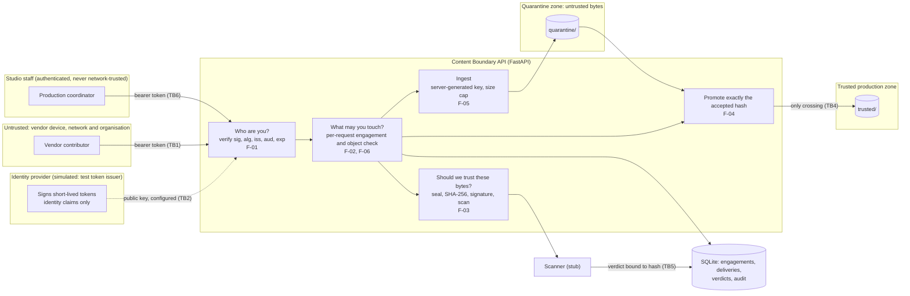
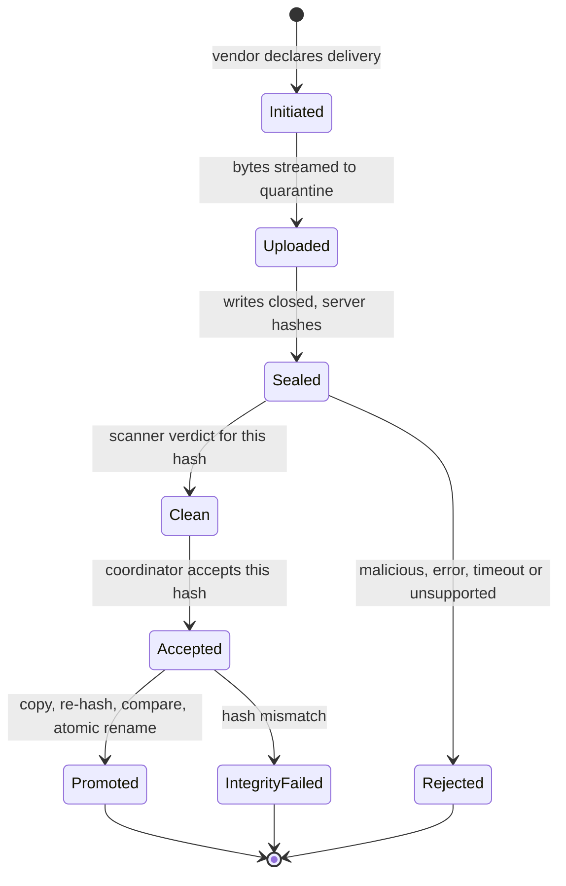

> **Preserved record.** This is the M0 proposal exactly as accepted on 2026-11-03, copied verbatim from the Claude Code session in which it was written. It has not been edited; statements such as "I haven't changed anything in the repository" describe the state when it was written. Corrections and later decisions are recorded in [M0-ADDENDUM.md](M0-ADDENDUM.md) and [../decisions.md](../decisions.md), which take precedence where they differ.

---

# Content Boundary Lab: M0 proposal

**Status:** This is a proposal only. I haven't changed anything in the repository; it still holds the one-line README from the initial commit. The only file work was a text extraction of the MovieLabs PDF in my scratchpad.

**What the tags mean**
- **[Ref]**: I checked this against the cited primary source during M0. Versions and links are in §11.
- **[Assume]**: a design premise we are choosing. It could reasonably be different.
- **[Rec]**: my recommendation or judgement. This includes CWE and OWASP mapping calls the references don't settle.

---

## 0. Summary

The concept is sound. These are my main changes:

1. **Organise everything around three questions.** Who are you? What may you touch? Should we trust these bytes? MovieLabs CSAP covers the first two and puts the third outside its scope, so the third is where this lab adds something new.
2. **Replace the per-file human "security approval".** Use an automated content-trust gate that production staff can't override. Add a coordinator's *acceptance* that is bound to the SHA-256 of the exact bytes they accepted.
3. **Reshape three findings so each has one realistic root cause.**
   - F-03 becomes a scan cache keyed on the hash the vendor declares (a shortcut to save scanning time), not a literal `scan_status` field.
   - F-05 narrows to a single path-traversal root cause.
   - F-06 becomes "authorisation snapshot in a long-lived token".
4. **Isolate vulnerable code at named "seams", never with feature flags.** A seam is one function that makes a security decision. Each vulnerable variant swaps out exactly one seam, and only in test-only app builds.
5. **Re-sequence the milestones** so the default app is never vulnerable in any commit.

I recommend six findings, with an agreed cut line: F-01 is dropped first if time runs short.

---

## 1. Critique of the concept

**What already works**
- **The problem is real and under-served.** External partners work on unreleased content, and their organisation, identity, device and network all have to be treated as untrusted. [Ref] CSAP v1.3 is itself a zero-trust architecture that treats authentication and authorisation as separate functions (Part 1 §3.1, §3.4).
- **Choosing depth over breadth is right.** Most deliberately vulnerable repositories are broad and shallow. Five or six well-evidenced findings will stand out more.

**What I would change** [Rec]

| # | Issue | Why it matters | Change |
|---|---|---|---|
| 1 | "Security approval" is underspecified. A human security approver per file doesn't scale. | It contradicts the low-friction goal, and reviewers will read it as unrealistic. | Use an automated trust gate (hash, type, scan). Add human *production* acceptance bound to the hash. The security team handles exceptions; this is documented but not built. |
| 2 | The three trust decisions are blurred together. | Most real failures in this area come from mixing them up. | Make identity, authorisation and content trust the spine of the code modules, the findings and the README. CSAP frames the first two as "Who are you? Are you allowed to do this?" [Ref, Part 1 §3.4]. It also says that ensuring a trusted artefact is actually trustworthy is not CSAP's role [Ref, §1.1.1]. That gap is this lab's niche. |
| 3 | The findings overlap or vary in depth. F-05 is a grab-bag, F-01 and F-06 can blur together, and a literal `scan_status: clean` field looks like a CTF puzzle. | Shallow findings weaken the deep ones. | One root cause per finding (§5). |
| 4 | Findings could look planted. | Credibility with experienced reviewers. | Give each vulnerable variant a plausible engineering motive (a gateway assumption, the cost of rescanning, a re-upload convenience) and write it up as part of the root cause. |
| 5 | An API-only lab can't demonstrate "the coordinator needs little security knowledge". | The claim can't be verified. | Turn it into secure defaults we can test: an end date is mandatory and capped, roles come only from presets, nothing "never expires", and nobody can override a failed check. |
| 6 | The isolation approach isn't specified. | Feature flags would put vulnerable paths in the default app. | Seam substitution (§6). |
| 7 | The milestone order has a paradox. | If M1 builds a secure baseline, M3 has nothing to fix. If M1 builds a naive app, the default app is vulnerable in the git history. | Re-sequence (§9). |
| 8 | References drift over time. | A wrong ID undermines the whole repository. | Pin reference versions and record retrieval dates. Example found in M0: CWE-613 is now **deprecated**, with mapping usage "Prohibited", and MITRE points to CWE-1463 or CWE-1464 instead. OWASP Top 10:2025 A07 still lists CWE-613 [Ref]. |
| 9 | Naming real companies, even in a disclaimer. | It implies an association. | Use a generic "not affiliated with any studio, vendor or standards body" disclaimer, reserved domains (`.example`, `.test`; RFC 2606, not re-checked in M0) and obviously synthetic code names such as PRODUCTION-ALPHA. |
| 10 | An "independent" review by the same AI that wrote the code isn't independent. | Overclaiming undermines trust. | M4 becomes a fresh-context review plus tool scans, ideally with one human reviewer. Label it honestly. |
| 11 | The temptation to claim ASVS compliance. | Several relevant requirements are Level 3 (8.3.2, 15.4.2) [Ref]. | Map each finding to specific requirements and never claim a level. |

---

## 2. Workflow to model

**Scenario [Assume].** A studio's PRODUCTION-ALPHA engages a freelance compositor from the fictional `vendor-one.example` to deliver VFX shots. PRODUCTION-BRAVO exists in the same system and has no relationship with the vendor.

| Step | Actor | What happens | Trust question | Finding |
|---|---|---|---|---|
| (all) | Every caller | The app verifies the identity token on every request | Who are you? | F-01 |
| 1 Engage | Coordinator | Creates an engagement: vendor subject, production, role preset, and a mandatory end date (capped, e.g. 90 days) | What may they touch? | F-06 |
| 2 Fetch references | Vendor | Lists and downloads ALPHA reference assets | What may they touch? (per object) | F-02 |
| 3 Initiate delivery | Vendor | Sends JSON: display filename, declared size, declared SHA-256, media type | Ingest | F-05 |
| 4 Upload | Vendor | Streams raw bytes with a PUT into quarantine, under a size cap enforced while streaming | Ingest | F-05 |
| 5 Seal | Vendor → server | Writes close. The server computes SHA-256, checks the file signature against an allowlist and calls the scanner. The verdict is bound to the hash. | Trust these bytes? | F-03 |
| 6 Accept | Coordinator | Accepts the specific hash shown. Only allowed if the verdict for that hash is clean; vendors can't accept. | Trust these bytes? | F-04 |
| 7 Promote | System job | Copies quarantine → trusted, hashing during the copy, comparing, then atomically renaming | Trust these bytes? | F-04 |
| 8 End | Coordinator or clock | Revocation or expiry. The next request is denied without waiting for the token to expire. | What may they touch? (lifecycle) | F-06 |

**Why this workflow** [Rec]
- It exercises all three questions, and each finding sits at exactly one step.
- It mirrors CSAP's idea that authorisation rules come from the workflow and last no longer than the activity, covering only the resources involved [Ref, Part 1 §5.2]. This is an analogy, not a claim of conformance.

**Alternatives considered**
- **Outbound only** (screeners or dailies): strong on authorisation, but there is no content-trust story, and it invites watermarking or DRM claims we can't honestly make.
- **Vendor-federated identity:** more realistic for large vendors, but it hands offboarding to the vendor. I'd document it as a deployment variant. The app's own end dates are the backstop either way.
- **Shot or work-package scoping:** more realistic, since vendors usually see only the shots assigned to them, but it adds a model. I suggest it as a later extension (D4).

---

## 3. Actors, assets, trust boundaries and threat model

**Actors**

| Actor | Trust stance |
|---|---|
| Vendor contributor (external) | Authenticated by the identity provider. Device, network and organisation untrusted. |
| Production coordinator (internal) | Authenticated. Gets no trust from network location. |
| Scanner (service) | Trusted to *produce* verdicts, not trusted to be *correct* (stub in the lab). |
| Identity provider (simulated) | Trusted for identity assertions only, never for project permissions. |
| Platform operator | Out of scope. |

**Attacker profiles**
- **T1: over-reaching vendor user.** A legitimate account acting outside its grant. This is the most likely case.
- **T2: compromised vendor account or token.** Phishing, or malware on the vendor's workstation.
- **T3: former vendor.** The engagement has ended or been revoked.
- **T4: unauthenticated attacker** who can reach the API or internal paths.
- **T5: malicious content.** The file is the attacker, and the uploader may be innocent.

**Out of scope:** a malicious studio admin, a compromised identity provider or signing key, infrastructure compromise, screen capture or other client-side leaks, and denial of service beyond upload size limits.

**Assets**
- **A1:** unreleased reference content (confidentiality).
- **A2:** the trusted production store (integrity).
- **A3:** engagement records (integrity).
- **A4:** scan verdicts and acceptance records (integrity, plus their binding to the bytes).
- **A5:** the audit trail (attribution for leak investigations).
- **A6:** the token verification configuration: public key, issuer, audience.

**Trust boundaries**
- **TB1:** vendor environment → API.
- **TB2:** identity provider → API (identity assertions, verified by cryptography, not network location).
- **TB3:** API → engagement store, the server-side source of truth for authorisation.
- **TB4:** quarantine → trusted store. Promotion is the only crossing.
- **TB5:** scanner → API (verdicts).
- **TB6:** staff → API. Internal users don't get network-based trust either.

**Threats** (STRIDE per boundary, maintained in `docs/threat-model.md`)

| Boundary | Threat | Attacker | Reference control | Finding |
|---|---|---|---|---|
| TB1/TB2 | Spoofing: identity taken from a header that a gateway supposedly sets | T4, T1 | The app verifies the signed token itself and ignores identity headers | F-01 |
| TB3 | Disclosure: another production's asset read by ID | T1, T2 | One query binds asset → production → active engagement | F-02 |
| TB3 | Elevation: a revoked or expired engagement still works | T3 | Engagement looked up on every request; injectable clock | F-06 |
| TB1→TB4 | Tampering: writes outside quarantine via the filename | T1, T2 | Server-generated storage keys plus a containment check | F-05 |
| TB5 | Tampering: data the caller supplied decides the scan outcome | T1, T2, T5 | Verdict keyed on a hash the server computes itself | F-03 |
| TB4 | Tampering: bytes swapped after acceptance | T1, T2 | Seal, hash binding, and hashing while copying | F-04 |
| TB1 | Denial of service: oversized upload | T1, T4 | Size cap enforced while streaming | Baseline |
| TB6 | Repudiation: an action attributed to the wrong actor | T1 | Audit events use the verified subject only | Baseline |
| TB4 | Real malware gets past the stub | T5 | None. The stub has no detection value. | Limitation |

Every row must map to a control and a test, or be explicitly marked out of scope.

---

## 4. Proposed architecture

- **One FastAPI process.** Routers are thin and call plain-Python domain services, which call stores.
- **Six seams.** Each is one function that makes a security decision; the vulnerable variants replace them.
- **Storage.** Separate quarantine and trusted roots, with server-generated keys.
- **Data.** SQLite through stdlib `sqlite3` with parameterised queries.
- **Audit.** An append-only table. It is not tamper-evident; that's a stated limitation.
- **Clock.** Injectable, so expiry tests need no sleeps.





**CSAP analogy (not conformance).** [Ref for the CSAP terms, Rec for the mapping] CSAP's core components are an Authentication Service, an Authorization Service, an Authorization Rules Distribution Service and Policy Enforcement Points (Part 1 §5). In the lab:
- Token verification consumes the Authentication Service's output.
- Engagement checks combine the Authorization Service and a Policy Enforcement Point inside one app. CSAP keeps these separate; we don't, and that's a stated limitation.
- CSAP's Trust Inference (§6.2) and device posture are conceptual only here.

**Cloud mapping (documented, not implemented).** Separate buckets or accounts for quarantine and trusted storage, with distinct roles allowed to write each. Immutable or versioned sealed objects, with promotion pinned to a specific object version. Scan verdicts writable only by the scanner's role. Federation through OIDC. I haven't verified the provider-specific details yet (open item V3).

---

## 5. Prioritised findings

The pattern for every finding: the same exploit test runs against the vulnerable variant, where it must **succeed** (a positive assertion, so demos can't silently stop working), and against the reference implementation, where it must be **blocked**. Assertions go beyond status codes: bytes returned, files present or absent under `trusted/`, the scanner's call count, and audit events.

| Priority | ID | Title | Boundary | Severity (in scenario) | Primary CWE | ASVS 5.0.0 |
|---|---|---|---|---|---|---|
| 1 | F-04 | Acceptance bound to a mutable reference | TB4 | High | CWE-367 | 15.4.2, 2.3.1, 2.3.3 |
| 2 | F-02 | Object access checks the parent, not the child | TB3 | High | CWE-639 | 8.2.2, 8.4.1 |
| 3 | F-03 | Scan gate satisfied by a caller-declared hash | TB5 | High | CWE-807 | 5.4.3, 2.2.2, 16.5.3 |
| 4 | F-05 | Client filename used to build the storage path | TB1→TB4 | High (Critical if the trusted store is consumed automatically) | CWE-22 | 5.3.2 |
| 5 | F-06 | Authorisation snapshot in a long-lived token | TB3 | Medium | CWE-863 | 8.3.2, 7.4.2 |
| 6 | F-01 | Identity taken from a header a gateway supposedly sets | TB1/TB2 | Critical (if the premise holds) | CWE-290 | 4.1.3, 8.3.1 |

Severity is qualitative and specific to this scenario, with the rationale written per finding [Rec]. I prefer this to CVSS for deliberately vulnerable code (D7).

### F-04: Acceptance bound to a mutable reference
- **Root cause and motive.** The acceptance records only `delivery_id`. Promotion copies whatever bytes are in quarantine at promotion time. The upload path stays writable after sealing, so vendors can "fix mistakes". In cloud designs this is exactly what happens when a pre-signed upload URL is still valid after the app marks the delivery sealed [Assume].
- **No tight race needed.** The window is the hours between acceptance and promotion.
- **Impact.** The coordinator accepted v1 and the trusted store receives v2, unscanned and unreviewed, while the audit trail says the coordinator approved it. That's both an integrity failure and an attribution failure.
- **Reproduce (deterministic, no threads).**
  1. Upload v1, seal, scan clean, accept.
  2. Overwrite the quarantine object through the still-open storage write path.
  3. Promote.
  - Vulnerable: the trusted bytes equal v2.
  - Reference: promotion aborts on hash mismatch, nothing lands in `trusted/`, the state becomes `IntegrityFailed`, and an audit event is written. A separate test shows the API's PUT after sealing returns 409.
  - Together these show the fix doesn't rely on the API state check alone.
- **Fix.** Seal closes writes. The server computes the hash at seal time. The verdict and the acceptance both bind to that hash. Promotion hashes the bytes *as it copies them* into a temp file inside `trusted/`, compares, then renames atomically. The state change is a compare-and-set inside one transaction.
- **Mappings.**
  - CWE-367 (Base, mapping allowed) [Ref].
  - ASVS 15.4.2 (L3): a state check and the action that depends on it must be atomic. 2.3.1 (L1): enforce step order. 2.3.3 (L2): transactional business operations [Ref].
  - CWE-367 is not in A08:2025's CWE list [Ref]. The closest Top 10 category is A06:2025 Insecure Design [Rec; I haven't checked A06's CWE list].
- **Limits.** Atomic rename assumes POSIX semantics on the same filesystem. Version pinning in the cloud is conceptual only.

### F-02: Object access checks the parent, not the child (BOLA)
- **Root cause and motive.** On `/productions/{production_id}/assets/{asset_id}`, the code checks the caller's engagement on the `production_id` from the path, then loads the asset by `asset_id` alone. The check *exists*, so it passes a quick review. Unguessable IDs (UUIDs) don't help: they leak through logs, shared manifests and links.
- **Impact.** Cross-production reads of unreleased content. This is the headline risk.
- **Reproduce.** A vendor engaged only on ALPHA requests a BRAVO asset ID through the ALPHA path.
  - Vulnerable: 200 with the bytes.
  - Reference: 404.
  - Matrix: BRAVO path, nonexistent ID, coordinator role. Also assert that "missing" and "forbidden" give identical responses, so the API doesn't reveal which assets exist.
- **Fix.** One repository query binds asset → production → active engagement for the subject. Deny by default, and log the authorisation failure.
- **Mappings.**
  - CWE-639 (Base). CWE-566 (Variant: the user-controlled key is the SQL primary key). Both are listed under A01:2025 [Ref].
  - ASVS 8.2.2 (L1): data-level access only with explicit permission. 8.4.1 (L2): cross-tenant controls. 16.3.2 (L2): log failed authorisation [Ref].
  - Treating productions as tenants is my call [Rec]. OWASP API1:2023 Broken Object Level Authorization [Ref for the category, Rec for the mapping].
- **Limits.** Access is scoped per production, so over-exposure *within* a production isn't addressed (D4).

### F-03: Scan gate satisfied by a caller-declared hash
- **Root cause and motive.** Rescanning multi-gigabyte re-deliveries is slow, so the vulnerable variant caches clean verdicts by SHA-256. It looks the cache up using the hash the *vendor declares* at initiation; delivery manifests routinely carry checksums.
- **Impact.** Unscanned content becomes eligible for acceptance. Combined with automatic promotion, it reaches the trusted store.
- **Reproduce.** The stub flags a synthetic marker string.
  1. Upload a clean file; its verdict gets cached.
  2. Upload a marker file, declaring the clean file's hash.
  - Vulnerable: the state becomes `Clean` and the scanner is never called.
  - Reference: the server's own hash doesn't match the declared one, so the delivery is rejected (422). The scan runs on the server-computed hash either way.
- **Fix.** Key verdicts on the hash the server computes from the stored bytes. Use the declared checksum only to detect corruption in transit. Scanner errors, timeouts and unsupported types fail closed. Each verdict records the scanner's identity and version.
- **Mappings.**
  - CWE-807 (Base), related CWE-348 "Use of Less Trusted Source" (Base) [Ref].
  - Not CWE-345: MITRE marks that Class "Discouraged" for mapping, even though A08:2025 lists it [Ref].
  - ASVS 5.4.3 (L2): scan files from untrusted sources. 2.2.2 (L1): validate at a trusted service layer. 16.5.3 (L2): fail closed [Ref].
- **Why not the literal field.** A literal `scan_status` field is the mass-assignment variant (CWE-915, ASVS 15.3.3). Reviewers would spot it instantly, so I hold it as an alternative (D3).
- **Limits.** The stub has zero detection value. Caching clean verdicts is itself a trade-off, because signatures update; we should recommend rescanning at promotion or a time limit on cached verdicts.

### F-05: Client filename used to build the storage path
- **Root cause and motive.** The path is built from the quarantine root, the production and the client's filename. A `replace("../", "")` "sanitiser" is added, which `....//` defeats.
- **Why the filename is raw.** It arrives in the JSON initiation request, so no framework touches it.
- **Absolute-path variant.** Python's path joining discards earlier components when a later one is absolute (Python documentation; not re-checked in M0).
- **Impact.** The vendor writes straight into `trusted/`, bypassing seal, scan and acceptance, or overwrites another production's trusted asset. The content boundary collapses entirely.
- **Reproduce.** Run a payload corpus: `../`, `....//`, an absolute path, backslashes, percent-encoding, NUL bytes, Unicode lookalikes, overlong names. Everything stays inside pytest's `tmp_path`, so the blast radius is bounded.
  - Vulnerable: a file appears under `tmp_path/trusted/…`.
  - Reference: the file is stored under a UUID key in quarantine, and the display name is validated or rejected.
- **Fix.**
  - Never derive a path from client data.
  - The display name is metadata only. It is validated, and it is encoded in `Content-Disposition` on download (ASVS 5.4.1, 5.4.2).
  - As defence in depth, check that the resolved path stays inside the storage root.
- **Mappings.**
  - CWE-22 (Base, Stable), plus CWE-36 for the absolute variant. Both are listed under A01:2025 [Ref]. CWE-73 is related but not on A01's list [Ref].
  - ASVS 5.3.2 (L1) [Ref].
  - The OWASP File Upload Cheat Sheet recommends server-generated names [Ref].
- **Baseline controls, not findings.**
  - A size cap enforced while streaming (ASVS 5.2.1, CWE-770).
  - Extension plus file-signature allowlist (ASVS 5.2.2). The cheat sheet warns that signature checks are easy to bypass and shouldn't be used alone [Ref].
  - No archives accepted at all, which keeps zip-slip and decompression bombs out of scope.
- **Limits.** Tested on POSIX only. Windows path semantics differ.

### F-06: Authorisation snapshot in a long-lived token
- **Root cause and motive.** The vulnerable variant authorises from a `productions` claim baked into a 12-hour token at issuance, the way identity-provider group claims are often used. Revoking the engagement, or reaching its end date, has no effect until the token expires.
- **Impact.** A former vendor keeps access for hours. Revocation during a suspected leak fails exactly when it matters.
- **Reproduce.**
  - Mint a token with the claim, revoke the engagement, request again. Vulnerable: 200. Reference: 403.
  - Move the injectable clock past the end date. Reference: 403.
  - A token that *claims* BRAVO grants nothing in the reference.
- **Fix.** Tokens carry identity only. They are short-lived (D-value, e.g. ≤ 15 minutes). The engagement is looked up on every request, requiring that it isn't revoked and hasn't ended. The end date is mandatory.
- **Mappings.**
  - CWE-863 (Class, "Allowed-with-Review"). I'll justify in the write-up that no Base child fits stale authorisation better. CWE-1464 (Improper Session Invalidation) is related [Ref].
  - **Not CWE-613** (deprecated, "Prohibited").
  - ASVS 8.3.2 (L3): authorisation changes apply immediately, or compensating controls exist. 7.4.2 (L1): end sessions when an account is disabled. 9.2.1 (L1): enforce token validity times [Ref].
- **Honesty note.** ASVS 8.3.2 explicitly allows compensating controls when self-contained tokens make immediate revocation impossible. So F-06 is a finding *against our stated requirement*: immediate revocation for time-boxed external access to unreleased content. It isn't universally wrong, and the write-up must say so.

### F-01: Identity taken from a header a gateway supposedly sets
- **Root cause and motive.** The app reads the subject from an `X-Authenticated-User`-style header, assuming an authenticating proxy always sets it.
- **Real-world failure modes.** The proxy doesn't strip a client-supplied copy. The app is reachable on a path that bypasses the proxy. An attacker uses SSRF from inside the network.
- **Impact.** Impersonation of anyone, including the coordinator.
- **Reproduce.**
  - Send the header naming the coordinator, with no token. Vulnerable: 200. Reference: 401.
  - Send the header together with a valid vendor token. The reference acts as the vendor and logs a bypass attempt (ASVS 16.3.3).
- **Fix.** The app verifies the token itself: signature, pinned algorithm (ASVS 9.1.1, 9.1.2), trusted key source (9.1.3), `exp` and `nbf` (9.2.1), and `aud` (9.2.3).
- **Mappings.**
  - CWE-290 (Base), related CWE-348; CWE-290 is listed under A07:2025 [Ref].
  - ASVS 4.1.3 (L2): headers set by intermediaries mustn't be overridable by end users; its examples include `X-User-ID`. 8.3.1 (L1). 8.4.2 (L3): network location can't be the only factor for admin interfaces [Ref].
  - OWASP API2:2023 Broken Authentication [Rec].
- **Why it's first to cut.** It's the most generic finding, and its premise (the gateway) is documented rather than reproduced. The reference baseline already demonstrates verified identity.

**Considered but not chosen:**
- Mass assignment of delivery state (F-03 alternative).
- Self-acceptance or separation of duties. This becomes a baseline function-level control (ASVS 8.2.1); 2.3.5 multi-user approval is L3.
- Archive handling.
- Disabled JWT signature verification (F-01 alternative, D2).

---

## 6. Secure implementation approach, and avoiding misleading mock security

**Reference design** [Rec]
- **Identity.** `authenticate(request) → Principal` returns identity only. Authorisation is per request and deny-by-default. Content trust is a state machine that only accepts facts the server derived itself.
- **No home-grown authentication.** No passwords, no login endpoint, no custom token format. The app is a relying party that verifies ES256 tokens with PyJWT and `cryptography`.
- **Stdlib for everything else.** `hashlib`, `sqlite3` (parameterised queries), `pathlib`, `uuid` and `secrets`.

**Isolating vulnerable code**
- **Six named seams.** The reference implementations live in `src/`. The vulnerable ones live in `labs/fNN_*/vulnerable.py`, each with a warning banner.
- **Test-only lab apps.** Lab apps are built only inside tests, using FastAPI's `dependency_overrides` (a documented testing feature; not re-checked in M0) or constructor injection.
- **Guard tests.**
  1. An AST scan proves nothing in `src/` imports `labs`.
  2. The default `create_app()` wires no lab callables.
  3. Packaging excludes `labs/`. This matches ASVS 15.2.3, which says production builds contain no test or sample code [Ref].
  4. No entry point serves a lab app. Lab apps run in-process only, with no socket.
- **Before/after.** The before-and-after for each finding is literally one function. The parameterised tests prove the regression suite fails when that one function is reverted.

**Avoiding misleading mock security**
- **Name simulated parts honestly.** `TestTokenIssuer` keys are generated in memory per test run, so no private key is ever committed and secret scanners stay quiet. `StubScanner` is marker-based. `LocalObjectStore` stands in for buckets.
- **Contracts for simulated parts.** Each simulated component gets a written contract that a real implementation must meet, plus a contract test. For the scanner: the verdict is bound to the hash, it fails closed on error, timeout or unsupported type, and it records the engine and version.
- **No EICAR test file.** Antivirus on contributors' machines may quarantine repository files and break clones in confusing ways. Use a lab-specific synthetic marker instead.
- **An "Implemented / Simulated / Conceptual" table** in the README.
- **Careful wording.** Never write "secure" unqualified. Write "mitigates F-01 to F-06 under the stated assumptions".
- **Fail closed everywhere** (ASVS 16.5.3).
- **No TLS locally.** Say so explicitly: the reference app binds to 127.0.0.1 only.

---

## 7. Repository structure and stack

| Area | Choice | Notes |
|---|---|---|
| Language | Python ≥ 3.12 | 3.13.7 is installed here; no `.venv` exists yet (D6) |
| Web | FastAPI | Exact version pinned in M1 after checking current releases |
| Tokens | PyJWT + cryptography | ES256, algorithms pinned, `iss`, `aud`, `exp`, `nbf` required |
| Data and files | stdlib `sqlite3`, `hashlib`, `pathlib` | No ORM |
| Run (optional) | uvicorn | Reference app only |
| Tests | pytest, httpx | FastAPI's TestClient needs httpx |
| Quality | ruff; bandit and pip-audit in M4 | Dev-only, pinned |
| Deliberately not used | python-multipart, ORM, Docker, frontend, Keycloak, ClamAV | Raw streamed PUT avoids multipart; Keycloak and ClamAV are optional later extras |

Every dependency needs your approval under CLAUDE.md (D5).

```
content-boundary-lab/
├── README.md  LICENSE  SECURITY.md  pyproject.toml
├── src/content_boundary_lab/      # reference implementation (default app)
│   ├── app.py                     # create_app(): reference seams only
│   ├── identity.py                # F-01 seam
│   ├── authz.py                   # F-02, F-06 seams
│   ├── ingest.py                  # F-05 seam
│   ├── trust.py                   # F-03 seam (seal, hash, signature, scan)
│   ├── promotion.py               # F-04 seam
│   ├── store.py  audit.py  clock.py
├── labs/                          # INTENTIONALLY VULNERABLE; never imported by src/
│   ├── README.md
│   └── f01_…/vulnerable.py … f06_…/vulnerable.py
├── tests/
│   ├── conftest.py                # in-memory keys, tmp_path stores, synthetic seed
│   ├── unit/
│   ├── findings/test_fNN_….py     # same exploit vs vulnerable and reference
│   └── guards/test_isolation.py
├── tools/check_docs.py            # relative links resolve; snippets match source
└── docs/
    ├── architecture.md  threat-model.md  references.md
    ├── findings/F-01-….md … F-06-….md
    └── milestones/M0.md … M5.md
```

**Links that won't drift.** Keep each vulnerable module tiny and link to the file rather than to line anchors, which drift. `tools/check_docs.py` (stdlib only) checks that every relative link resolves and that README diff snippets still match the source.

---

## 8. README structure

**Above the fold (60–90 seconds)**
1. Title, one-sentence purpose, badges (tests, licence), and a safety banner: "`labs/` contains intentionally vulnerable code; the default app does not."
2. The problem in three sentences, framed as the three questions.
3. The architecture diagram with finding tags (§4).
4. Findings table: ID, title, boundary, severity, CWE, ASVS, and links to vulnerable code, fix and tests.
5. Quick start: three commands, plus the expected summary ("6 exploits reproduced against vulnerable variants; 6 blocked by reference").
6. Implemented / Simulated / Conceptual table.

**Below the fold**

7. Scenario in five bullets.
8. One card per finding. Each has root cause (two lines), impact (one line), a collapsible `<details>` with the before/after diff, the reproduce command (`pytest tests/findings/test_f02_… -v`), the result, limitations, and a link to the full write-up.
9. Threat model summary and link.
10. Design decisions and trade-offs.
11. Limitations and non-goals.
12. References with pinned versions and retrieval dates.
13. Responsible use, licence, and the not-affiliated disclaimer.

---

## 9. Milestones M1–M5

**Re-sequencing** [Rec]
- **M1** builds the full reference workflow securely.
- **M2** adds the vulnerable seams and exploit tests.
- **M3** proves each fix: diffs, regression corpora, and fixes for any reference gaps M2 exposes. Those gaps are real bugs and start with a failing test, per CLAUDE.md.

The default app is never vulnerable in any commit, and the README doesn't claim a chronology. Every milestone is split into steps of roughly 3 files and 150 lines each, and each milestone report covers changes, evidence, decisions, limitations, risks and the acceptance checklist.

**M1: Reference baseline and architecture docs.** Steps:
1. Skeleton, pinned dependencies, a health test.
2. Store schema and synthetic seed.
3. Identity.
4. Engagements and authorisation.
5. Read path.
6. Ingest.
7. Seal, hash, signature check and scan.
8. Accept and promote.
9. Architecture, threat model and references docs.

Acceptance criteria:
- From a clean clone, the documented commands give a green `pytest -q`.
- Only approved, pinned dependencies are installed.
- No keys or secrets are in the repository.
- A test enumerates the routes and proves every one requires a verified token.
- An end-to-end happy-path test passes, plus negative tests for each control.
- Every threat-model row maps to a control and test, or is marked out of scope.

**M2: Vulnerable variants and reproducible findings.**
- Six `labs/` seams, test-only lab apps, parameterised exploit tests, draft write-ups, and active guard tests.

Acceptance criteria:
- Each exploit passes positively against its variant and is blocked by the reference, with state-level assertions.
- Each variant differs from the reference in exactly one seam.
- Guard tests prove the isolation.
- Every exploit stays inside `tmp_path`.
- CWE and ASVS mappings cite pinned versions.
- Any reference gap is logged for M3, not silently fixed.

**M3: Remediation evidence and regression suites.**
- **Token tampering matrix:** `none` algorithm, wrong key, wrong `iss` or `aud`, expired, future `nbf`, header plus token.
- **BOLA matrix:** across productions and roles.
- **Revocation and expiry:** the exact boundary timestamps.
- **Seal and tamper cases:** writes after sealing, plus out-of-band writes.
- **Declared-hash mismatches.**
- **Traversal corpus.**
- **Logging assertions:** denials are logged.

Acceptance criteria:
- Each finding has at least one bypass case for the *naive* fix (e.g. `....//`).
- Reverting any single seam makes its suite fail. This is automatic through the parameterisation.
- Every write-up explains why the fix addresses the root cause, not just the exploit.

**M4: Review, assurance and hardening.**
- A fresh-context review that sees the code, not my conclusions.
- Ideally, one human reviewer.
- ruff, bandit and pip-audit, plus a secret scan.
- A "claims audit" tracing every README security claim to a test ID.

Acceptance criteria:
- Every review item is triaged (fixed, accepted with rationale, or documented).
- No high-severity tool findings in `src/`. Any `labs/` exclusions are justified.
- Dependency audit exceptions are documented.

**M5: Documentation and publication readiness.**
- The final README and finding pages.
- A CI workflow written but not pushed.
- LICENSE and SECURITY.md (which separates "report a bug in the reference" from "this is intentional").
- A fresh-clone reproduction on macOS and Linux.
- A naming and trademark sweep.

Acceptance criteria:
- The link and snippet checker passes.
- A cold reader can state the project's purpose and the findings in about 90 seconds.
- Nothing is pushed or published without your explicit approval.

---

## 10. Risks, trade-offs, alternatives and open verification

**Risks**

| Risk | Mitigation |
|---|---|
| Findings look planted | Engineering motives, realistic code, external review |
| Scope creep | Six seams, no frontend, agreed cut line |
| Overclaiming security | Simulated-parts table, contracts, careful wording |
| Reference drift (as with CWE-613) | Pinned versions, retrieval dates, recheck in M5 |
| Publishing vulnerable code | Isolation guards, tiny snippets, banners, disclaimer |
| Link and snippet drift | `tools/check_docs.py` in tests |
| Review not truly independent | Human reviewer in M4 (D10) |

**Trade-offs**
- **Seam injection vs standalone mini-apps.** Seams give a single source of truth and a precise before/after, at the cost of a few injection points.
- **Self-contained JWTs vs opaque tokens with introspection.** Opaque tokens make revocation trivial but need a token service, which would mean more home-grown machinery.
- **Per-request lookup vs scale.** Real systems would cache briefly; the write-up should document this.
- **A synchronous scan inside the request** is a simplification.

**Alternatives for later**
- Keycloak in Docker as a real local identity provider.
- A ClamAV adapter.
- Work-package scoping.
- A policy engine such as OPA or Cedar. Overkill for now.

**Open verification**
- **V1:** Starlette raw-body streaming and size enforcement, with no hidden buffering (M1).
- **V2:** PyJWT's current version and its required-claims behaviour (M1).
- **V3:** cloud specifics: who can write scan-verdict tags, whether pre-signed URLs can be revoked, object versioning. Needed before the cloud-mapping docs.
- **V4:** CSAP Parts 4 and 5. I only read Part 1.
- **V5:** A06:2025's CWE list, which matters for the F-04 mapping.
- **V6:** RFC 8725, RFC 2606, and the FastAPI and Python documentation points. I cited these from memory and didn't re-fetch them.
- **V7:** whether the TPN vendor-assessment programme adds anything (not reviewed).

---

## 11. References (retrieved 2026-11-03)

- [OWASP ASVS 5.0.0](https://github.com/OWASP/ASVS/tree/v5.0.0_release/5.0/en) (tag `v5.0.0_release`; chapters V2, V4, V5, V7, V8, V9, V15, V16 read)
- [MITRE CWE](https://cwe.mitre.org/): entries and mapping-usage fields checked through the CWE REST API
- [OWASP Top 10:2025](https://top10.owasp.org/2025): category names, and the CWE lists for A01, A07 and A08
- [OWASP API Security Top 10 2023](https://api-security.owasp.org/editions/2023/en/0x11-t10)
- [OWASP File Upload Cheat Sheet](https://cheatsheetseries.owasp.org/cheatsheets/File_Upload_Cheat_Sheet.html)
- [MovieLabs CSAP v1.3 Part 1: Architecture Description (1 Aug 2023)](https://mc.movielabs.com/pdf/ML_CSAP_v1.3_Pt1_Arch.pdf) and the [CSAP overview](https://movielabs.com/production-technology/production-security/). CSAP Part 1 itself cites NIST SP 800-207.

---

## Recommendation

Proceed to M1 with:
- the six reshaped findings, F-01 first to cut;
- seam-based isolation;
- the re-sequenced milestones;
- the reference app built as a relying party with identity-only tokens and per-request authorisation.

**To settle before M1**

| # | Decision | My recommendation |
|---|---|---|
| D1 | The findings set and cut line | All six; drop F-01 first if needed |
| D2 | F-01 variant | Trusted identity header (rather than disabled signature verification) |
| D3 | F-03 variant | Declared-hash scan cache (rather than mass assignment) |
| D4 | Authorisation granularity | Per production in M1; work packages later |
| D5 | Dependencies | fastapi, pyjwt, cryptography, uvicorn (optional); dev: pytest, httpx, ruff; M4: bandit, pip-audit. All pinned. |
| D6 | Python floor | 3.12 |
| D7 | Severity scheme | Qualitative, with rationale; no CVSS |

**Can wait until M2 to M5**
- **D8: licence.** MIT or Apache-2.0 for code, CC BY 4.0 for docs.
- **D9: commit identity.** The initial commit's author email is on a company domain. Confirm that's the identity you want on a public project and that any outside-work or IP policy is satisfied.
- **D10: a human reviewer for M4.**
- **D11: token lifetime and engagement cap,** e.g. 10 minutes and 90 days.

I've stopped at M0 as you asked.
