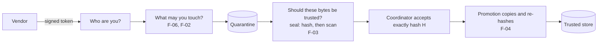
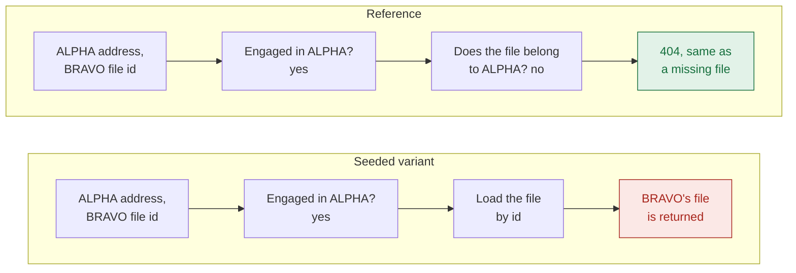
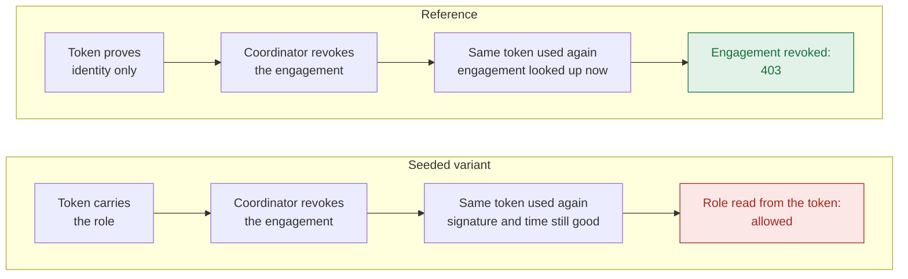
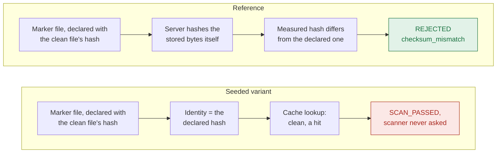
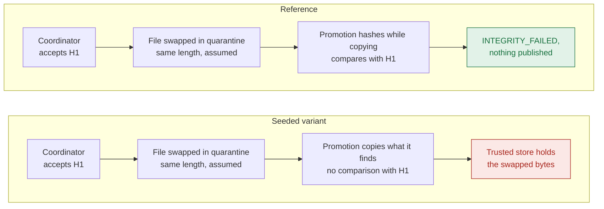

# Tour of the four findings

A short route into the lab for someone who learns by example. Each finding has the same five parts: the context, the planted flaw, the
attack, the fix and why it works, and the result. The quoted code and the quoted output are checked against the repository by
[`tools/check_docs.py`](../tools/check_docs.py), and the step tables are copied from the [evidence files](evidence/summary.txt).
Everything is synthetic, and the lab was verified on CPython 3.13 on macOS arm64 only ([publication.md](publication.md)).

The lab has no screen to capture, because it is an API and a command-line program. The output below is what it prints.

## The idea

A studio runs two productions, ALPHA and BRAVO. A coordinator hires outside vendors for a limited time (an *engagement*, at most
90 days). A vendor uploads a file into *quarantine*. The server checks it, a coordinator accepts it, and a system job moves it to the
*trusted store*, where the production's people can read it. A vendor on ALPHA must never touch BRAVO.

Every request has to answer three questions: **who are you**, **what may you touch** and **should these bytes be trusted**. Each
finding breaks one of them, in one function. For each, the lab swaps that single function for its seeded twin and replays the same
attacker steps. If the flaw is real, the attack works on the twin and fails on the reference.



## F-02: object access checks the parent, not the child

**Context.** A file is fetched with an address like `/productions/ALPHA/assets/<id>`. The server asks whether you are engaged in
ALPHA, the production named in the address. A vendor on ALPHA must never see BRAVO's unreleased files.

**The planted flaw.** The lookup uses the production from the address to check the caller, then loads the asset by its id alone.
The asset's own production is never compared with the address.

<!-- snippet: labs/f02_parent_check/vulnerable.py#get_asset_in_scope -->
```python
def get_asset_in_scope(conn, caller, production_id, asset_id, now_micros):
    row = conn.execute(_LOOKUP, (asset_id, production_id, caller.issuer, caller.subject, now_micros)).fetchone()
    return None if row is None else Asset(*row)
```

**The attack.** A vendor engaged only in ALPHA asks for a BRAVO asset through ALPHA's address.



| What happens | Seeded variant | Reference |
|---|---|---|
| An ALPHA vendor reads ALPHA's own asset through the ALPHA address (control) | `200, 4500 bytes: exactly ALPHA's asset` | the same |
| The same vendor asks for BRAVO's asset through the ALPHA address | **leaks:** `200, 3500 bytes: exactly BRAVO's asset` | **refused:** `404 {"detail":"Not found"}` |
| What the audit trail recorded | `asset.read allowed, production ALPHA, object BRAVO asset` | `access.denied denied (not_found_or_forbidden), production ALPHA, object BRAVO asset` |
| Does the refusal look like asking for a file that does not exist? | `False` | `True` |
| An ALPHA coordinator asks for BRAVO's asset through the ALPHA address | `200, 3500 bytes: exactly BRAVO's asset` | `404 {"detail":"Not found"}` |
| A vendor engaged in both asks for BRAVO's asset through the ALPHA address | `200, 3500 bytes: exactly BRAVO's asset` | `404 {"detail":"Not found"}` |

The last row is the subtle one. That vendor may read BRAVO's file, but only through BRAVO's address. Through ALPHA's address the read
is authorised and logged under the wrong production. Both variants answer `200, 3500 bytes` when that vendor uses BRAVO's address.

<!-- evidence: docs/evidence/f02.txt -->
```text
== REFERENCE
  2. the same vendor asks for BRAVO's asset through the ALPHA url
       -> 404 {"detail":"Not found"}
…
== SEEDED VARIANT (only the seam above is swapped)
  2. the same vendor asks for BRAVO's asset through the ALPHA url
       -> 200, 3500 bytes: exactly BRAVO's asset
```

**The fix and why.** The reference binds four things in one database query: the asset, the production that asset really belongs to,
the production named in the address, and the caller's current engagement. If any of them disagrees, the query returns nothing and the
server answers 404, the same answer as for a file that does not exist. One query leaves no gap between checking and loading, and the
identical 404 means an attacker cannot tell whether BRAVO's file exists. The code is
[`assets.get_asset_in_scope`](../src/content_boundary_lab/assets.py).

**The fix that looks right and is not.** Check that the caller is engaged where the asset lives, and stop comparing with the address
(N1). It repairs every caller engaged in one production. It still fails vendors engaged in both, who can read BRAVO's file through
ALPHA's address.

**The result.** The matrix runs 14 rows against each version.

<!-- evidence: docs/evidence/f02.txt -->
```text
RESULT     seeded variant exploited: YES   reference blocked: YES
```

<!-- evidence: docs/evidence/f02-matrix.txt -->
```text
R   fails: none  [as expected]
V   fails: X1, X2, X3, X4, X5, B2  [as expected]
N1  fails: X4, X5  [as expected]
A1  fails: none  [as expected]
RESULT     every variant fails exactly the rows it is expected to: YES
```

Write-up: [F-02](findings/F-02-object-access-checks-the-parent.md). Evidence: [f02.txt](evidence/f02.txt). Flawed code:
[`vulnerable.py`](../labs/f02_parent_check/vulnerable.py).

## F-06: authorisation snapshot in a long-lived token

**Context.** After login, the identity provider hands out a signed token that lasts at most ten minutes. The token proves who you are.
What you may do lives in the engagement database, where a coordinator can revoke it at any moment and where it ends on a fixed date.

**The planted flaw.** The seeded version reads your role from a `productions` claim that was written into the token when it was
issued. A revocation or an end date that comes later is invisible to it, because the token still carries the old answer.

<!-- snippet: labs/f06_stale_authorisation/vulnerable.py#authorize_engagement -->
```python
def authorize_engagement(conn, identity, production_id, action, now_micros):
    claims = CARRIED.get()
    role = (claims.get("productions") or {}).get(production_id)
    if role is None:
        raise AuthorizationDenied(AuditReason.NO_ENGAGEMENT)
    if action not in POLICY.get(role, frozenset()):
        raise AuthorizationDenied(AuditReason.ROLE_NOT_PERMITTED)
    return AuthorizedEngagement("0" * 32, role, claims["exp"] * 1_000_000, _proof=_AUTHORIZED)
```

**The attack.** Two attackers: a vendor whose engagement a coordinator just revoked, and a coordinator whose own engagement was
revoked while its token was still good.



| What happens | Seeded variant | Reference |
|---|---|---|
| The coordinator revokes a vendor's engagement. Does the same token still verify? | `signature, issuer, audience and times are good for vendor-alpha-1` | the same |
| The vendor asks for its engagement with that token | **allowed:** `200 vendor` | **refused:** `403 Forbidden` |
| What the audit trail recorded | `engagement.viewed allowed, by vendor-alpha-1` | `access.denied denied (engagement_revoked), by vendor-alpha-1` |
| The vendor declares another delivery | `201; deliveries created after the revocation: 1` | `403; deliveries created after the revocation: 0` |
| An engagement ends in five minutes. The vendor asks again 301 seconds later | `200, then 200` | `200, then 403` |
| The revoked coordinator makes a 90-day ALPHA engagement for another person | **grant made:** `201; engagements now held by that subject in ALPHA: 1` | **refused:** `403; engagements now held by that subject in ALPHA: 0` |
| The token has expired (`401`). That person, with a fresh token, asks for ALPHA's unreleased asset | **leaks:** `200, 4500 bytes` | **refused:** `403, never the bytes` |

The last two rows are why a coordinator's case is worse. The 90-day grant is an ordinary database row. It outlives the token, and it
survives fixing the code.

<!-- evidence: docs/evidence/f06.txt -->
```text
== REFERENCE
  4. the vendor asks for its engagement with that token
       -> 403 Forbidden
…
== SEEDED VARIANT (only the seam above is swapped)
  4. the vendor asks for its engagement with that token
       -> 200 vendor
```

**The fix and why.** The reference looks the engagement up in the database on every request and believes one thing in the token:
who you are. Role, production and end date come from the current row, and the end date is checked at the exact instant. A signature
proves the token was issued. It cannot prove the permission still exists, and only the database knows about a revocation. The code is
[`authz.authorize_engagement`](../src/content_boundary_lab/authz.py).

**The fixes that look right and are not.** N1: check the token's validity again. A valid signature and an unexpired token do not show
that the engagement is still active, so it fails the same rows as the seeded variant. N2: read the store on each request and check
revocation, but not the end date. It is right on the first request after a revocation and wrong from the end date on.

**The result.** The matrix runs 21 rows against each version.

<!-- evidence: docs/evidence/f06.txt -->
```text
RESULT     seeded variant exploited: YES   reference blocked: YES
```

<!-- evidence: docs/evidence/f06-matrix.txt -->
```text
R   fails: none  [as expected]
V   fails: L4, X1, X2, X3, X4, X5, X6, X9  [as expected]
N1  fails: L4, X1, X2, X3, X4, X5, X6, X9  [as expected]
N2  fails: X3, X4  [as expected]
RESULT     every variant fails exactly the rows it is expected to: YES
```

Write-up: [F-06](findings/F-06-authorisation-snapshot-in-a-long-lived-token.md). Evidence: [f06.txt](evidence/f06.txt). Flawed code:
[`vulnerable.py`](../labs/f06_stale_authorisation/vulnerable.py).

## F-03: caller-declared checksum used as content identity

**Context.** Scanning is slow, so the server remembers each verdict and reuses it for identical files. To know two files are identical
it needs an identity, and the natural choice is the file's SHA-256 hash, which the vendor declares when it announces a delivery. The
lab's scanner is synthetic: it recognises one made-up marker, which stands in for a malicious file.

**The planted flaw.** The seeded version uses the hash the vendor declared as the file's identity. The server never measures the
stored bytes, so the later check "does the declared hash match the file?" compares the claim with itself and cannot fail.

<!-- snippet: labs/f03_declared_identity/vulnerable.py#content_identity -->
```python
def content_identity(delivery, stored):
    return ContentIdentity(delivery.declared_sha256)
```

**The attack.** A vendor first delivers a clean file normally, so its verdict is cached. Then it delivers a marker file and declares the
clean file's hash.



| What happens | Seeded variant | Reference |
|---|---|---|
| A clean file is delivered and sealed: the scanner is asked and its verdict cached | `200 SCAN_PASSED, scanner calls: 1` | the same |
| The marker file is declared with the clean file's SHA-256 and its own size | `upload accepted, 935 bytes, declared sha256 b75f1f348b4f…` | the same |
| The vendor seals it | **passes:** `200 SCAN_PASSED` | **rejected:** `422 REJECTED (checksum_mismatch)` |
| The digest the server holds for the delivery | `b75f1f348b4f… (the declared clean digest)` | `1629f3591a5f… (the digest of the stored bytes)` |
| The audit events about that delivery, last two | `delivery.seal_started, delivery.verdict_reused` | `delivery.seal_started, delivery.rejected (checksum_mismatch)` |
| The coordinator inspects the delivery | `200 SCAN_PASSED` | `200 REJECTED` |
| Control: the same marker file declared truthfully | `422 detection, scanner calls so far: 2` | the same |

Both variants show `0` scanner calls for the seal, for different reasons: the seeded version skips the scanner because it believes
the cache, and the reference stops at the mismatch before it reaches the scanner.

<!-- evidence: docs/evidence/f03.txt -->
```text
== REFERENCE
  3. the vendor seals it
       -> 422 REJECTED (checksum_mismatch)
…
== SEEDED VARIANT (only the seam above is swapped)
  3. the vendor seals it
       -> 200 SCAN_PASSED
```

**The fix and why.** The reference hashes the stored bytes itself, in one pass, and uses that hash as the file's identity. It then
compares it with the declared hash, and a mismatch rejects the delivery before the cache is consulted. A trust decision has to rest on
something the server measured, because a label the sender wrote can say anything. The code is
[`trust.content_identity`](../src/content_boundary_lab/trust.py).

**The fix that looks right and is not.** N1: also check that the cache entry belongs to the declared digest. The entry always belongs
to the digest it was looked up by, so the check cannot fail while that digest is still the vendor's claim.

**The result.** The matrix runs 11 rows against each version. Trusted storage is not reached here: the independent promotion step (see
F-04) hashes what it copies and refuses these bytes, which is why the severity is Medium in this lab.

<!-- evidence: docs/evidence/f03.txt -->
```text
RESULT     seeded variant exploited: YES   reference blocked: YES
```

<!-- evidence: docs/evidence/f03-matrix.txt -->
```text
R   fails: none  [as expected]
V   fails: X1, X2  [as expected]
N1  fails: X1, X2  [as expected]
RESULT     every variant fails exactly the rows it is expected to: YES
```

Write-up: [F-03](findings/F-03-declared-checksum-used-as-content-identity.md). Evidence: [f03.txt](evidence/f03.txt). Flawed code:
[`vulnerable.py`](../labs/f03_declared_identity/vulnerable.py).

## F-04: promotion trusts a mutable reference, not the accepted bytes

**Context.** After sealing and scanning, a coordinator accepts one exact hash, H1. Later a system job promotes the delivery: it copies
the file from quarantine into the trusted store. In between, the file is just sitting in a folder, and the lab assumes something other
than the application is able to write to that folder.

**The planted flaw.** Promotion copies whatever is in quarantine at that moment and never compares what it wrote with H1.

<!-- snippet: labs/f04_unverified_promotion/vulnerable.py#copy_verified -->
```python
def copy_verified(source, target, promoting):
    for block in source.chunks():
        target.write(block)
    return target.finish()
```

**The attack.** After the coordinator accepted H1, something overwrites the quarantined file with different bytes of the same length.
The lab assumes this step and does not show how it could happen.



| What happens | Seeded variant | Reference |
|---|---|---|
| Version 1 is uploaded, sealed and scanned. The coordinator accepts its digest H1 | `200 SCAN_PASSED, then 200 ACCEPTED (H1 = 8e76af079d65…)` | the same |
| The vendor tries to upload version 2 through the API after the seal | `409 Delivery is not awaiting content` | the same |
| Assumed: something other than the application overwrites the file with version 2 | `1355 bytes, H2 = d9f32e8ad88d…, carries the lab marker: True` | the same |
| The promotion job runs | **promoted:** `PROMOTED, asset created` | **refused:** `INTEGRITY_FAILED, asset none` |
| Files under the trusted root, and what they hash to | `1 file: d9f32e8ad88d… (NOT the accepted digest)` | `0 files` |
| The digest the asset record claims | `8e76af079d65… (H1)` | `asset none` |
| An authorised caller downloads the asset | `200, 1355 bytes: exactly version 2 (the substituted bytes)` | no asset to download |
| The audit events about the delivery, last two | `delivery.promotion_started, delivery.promoted` | `delivery.promotion_started, delivery.integrity_failed` |

The worst part is the asset record and the audit trail. In the seeded variant both say the coordinator approved H1, while the bytes
served are different.

<!-- evidence: docs/evidence/f04.txt -->
```text
== REFERENCE
  4. the promotion job runs
       -> INTEGRITY_FAILED, asset none
…
== SEEDED VARIANT (only the seam above is swapped)
  4. the promotion job runs
       -> PROMOTED, asset created
```

**The fix and why.** The reference counts and hashes the bytes as it writes them, and raises an error unless they are exactly the
accepted bytes. Checking and using happen in the same pass, so there is no moment between the check and the copy for the file to
change. The code is [`promotion.copy_verified`](../src/content_boundary_lab/promotion.py).

**The fixes that look right and are not.** N1: compare the file's size with the accepted size. It stops swaps of a different length
and lets a same-length swap through. N2: hash the file in one pass and copy it in a second. The bytes checked are not the bytes used,
so a change between the two reads gets published.

**The result.** The matrix runs 11 rows against each version. The attacker's ability to write quarantine after acceptance is assumed,
not shown. Promotion checks that the bytes are the accepted bytes, and it does not look at anything that happened after the
acceptance, such as a revocation. That is the open limitation [M4-01](review/m4-findings.md).

<!-- evidence: docs/evidence/f04.txt -->
```text
RESULT     seeded variant exploited: YES   reference blocked: YES
```

<!-- evidence: docs/evidence/f04-matrix.txt -->
```text
R   fails: none  [as expected]
V   fails: X1, X2, X3, X4  [as expected]
N1  fails: X1  [as expected]
N2  fails: X8  [as expected]
RESULT     every variant fails exactly the rows it is expected to: YES
```

Write-up: [F-04](findings/F-04-promotion-trusts-a-mutable-reference.md). Evidence: [f04.txt](evidence/f04.txt). Flawed code:
[`vulnerable.py`](../labs/f04_unverified_promotion/vulnerable.py).

## One lesson from each

| Finding | The mistake | The rule |
|---|---|---|
| F-02 | Checked the address the request came through, then loaded the file by id alone | Check the thing you load against the thing you authorised |
| F-06 | Believed a permission copied into a signed token | A signature proves who you are. Ask the database what you may do, every time |
| F-03 | Used the hash the sender declared as the file's identity | Trust what the server measured, never what the sender declared |
| F-04 | Copied a file that could change after it was approved | Check the bytes you use, in the same pass that uses them |

To run all of this yourself, follow the [Quick start](../README.md#quick-start) and the [walkthrough](walkthrough.md).
